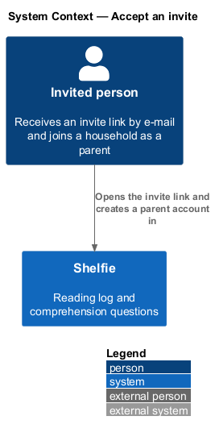
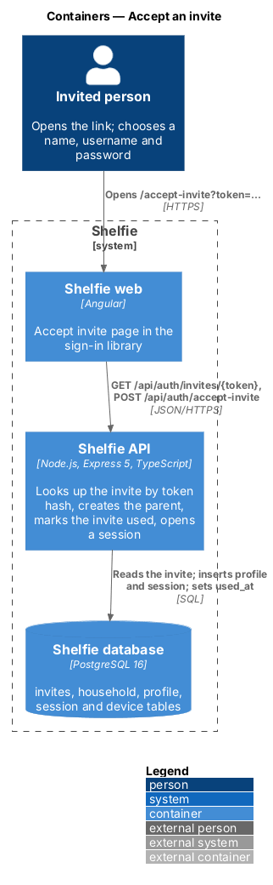
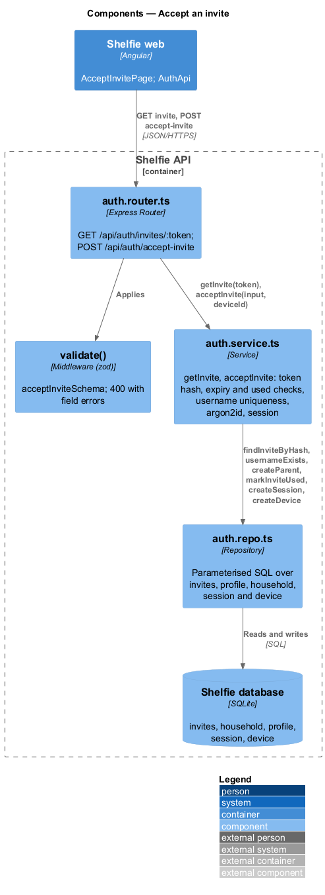
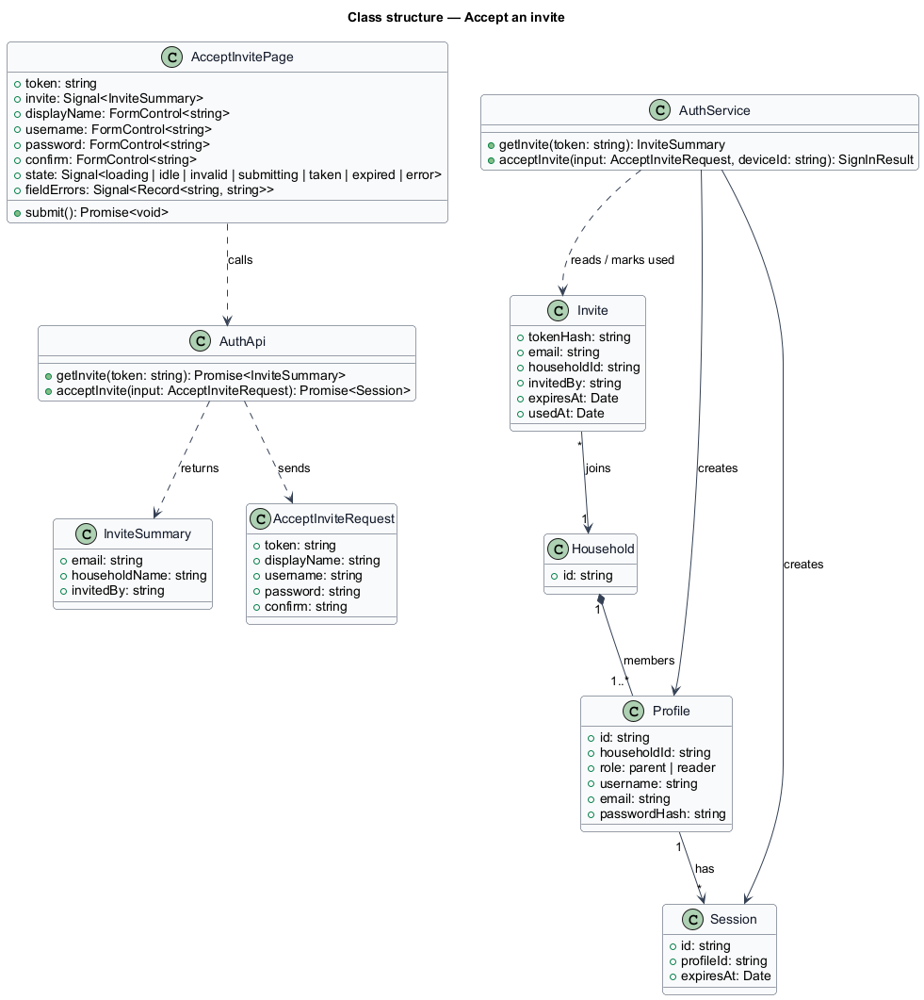
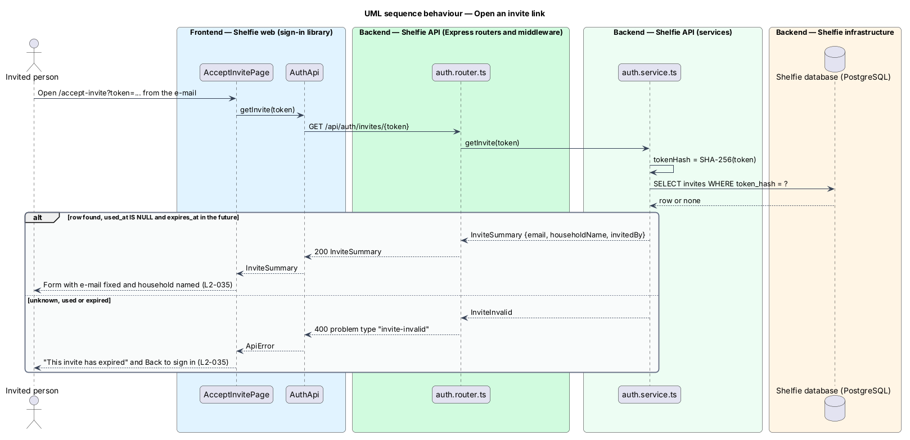
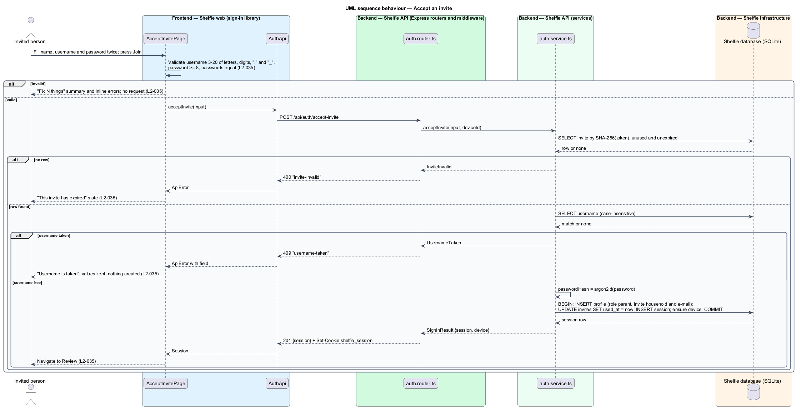

# Accept an invite

## Overview

Shelfie is a web application that helps children read books by logging each chapter they read and answering short questions about it, while a parent reviews the answers and gives rewards. A **household** is the unit of tenancy: a group of parents and readers sharing one bookshelf. Only parents hold accounts.

A parent already in a household can invite another parent by e-mail. The e-mail carries an **invite link**, which holds an **invite token**, a random secret that is valid for 7 days and can be used once. This feature covers what the invited person does with that link: opening it, creating a parent account inside the inviting household, and being signed in.

Opening the link shows the **Join a household** page, headed "Join the Bells" with "Marcus invited you." The e-mail field is fixed to the invited address. The person enters a display name, a **username** and a password typed twice. The username is the name used at every sign-in and is unique across all parents and readers, ignoring case. On success the parent account is created in the inviting household, the invite is marked used, the parent is signed in on this device and Review opens.

A link that is unknown, already used or past its 7 days shows "This invite has expired — Ask Marcus for a new one" with a Back to sign in action. The invite token is never stored; only its hash is, so a copy of the database does not yield working links (`L2-027`).

The feature sits in the `sign-in` subsystem beside parent sign-up, which starts a new household instead of joining one. Sending the invite belongs to the `settings` subsystem.

## Description

The slice runs from one page in the sign-in library to the `invites`, `profile`, `session` and `device` tables.

- **`AcceptInvitePage`** — page component in the `sign-in` library at `/accept-invite`, opened from the e-mailed link `/accept-invite?token=<token>`. On open it loads the invite. It owns the states in `docs/mocks/pages/accept-invite/`: `default`, `invalid`, `submitting`, `taken` and `error` (the expired or used link). The `default` state shows the read-only e-mail, Your name, Username and the two password boxes with a Join button. Client-side validation enforces the username length and character set, the 8-character minimum and equality of the passwords; failures show the "Fix N things" summary and field errors and send nothing. A `username-taken` answer shows "Username is taken" on the field with the entered values kept. An `invite-invalid` answer, at open or at submit, shows the expired state.
- **`AuthApi`** — `getInvite(token)` calls `GET /api/auth/invites/{token}` and returns an `InviteSummary` (`email`, `householdName`, `invitedBy`); `acceptInvite(input)` posts to `/api/auth/accept-invite` and returns a `Session`.
- **`auth.router.ts`** — `GET /api/auth/invites/:token` answers `200 InviteSummary` or `400` problem type `invite-invalid`. `POST /api/auth/accept-invite` validates with `acceptInviteSchema` (`token`, `displayName`, `username` matching `^[A-Za-z0-9._]{3,20}$`, `password` of at least 8 characters, `confirm` equal to `password`) and answers `201 {session}` with `Set-Cookie shelfie_session` and, when the device cookie is absent, `Set-Cookie shelfie_device`. Neither endpoint requires a session. The `GET` endpoint exists because the requirement shows the error state when the link is opened, not when the form is submitted.
- **`auth.service.ts`** — `getInvite(token)`: hashes the token with SHA-256, loads the row where `used_at IS NULL` and `expires_at` is in the future, otherwise fails with `invite-invalid`. `acceptInvite(input, deviceId)`: repeats that lookup, checks that the lower-cased username is unused (`username-taken`, HTTP `409`), hashes the password with argon2id (`L2-027`), then in one transaction inserts the `profile` with role `parent`, the invite's `household_id` and the invite's e-mail, sets `invites.used_at`, inserts the session and ensures the device row. A second submission of the same link therefore fails with `invite-invalid`.
- **`auth.repo.ts`** — `findInviteByHash`, `usernameExists`, `createParent`, `markInviteUsed`, `createSession`, `createDevice`. All SQL is parameterised.
- **Remember me** — the session created here is remembered (30-day idle timeout); the mocks show no control and the sign-in switch defaults to on.

Data changes, shared with parent sign-up:

- **`invites`** — new table: `token_hash TEXT PRIMARY KEY` (SHA-256 of the token), `email TEXT NOT NULL`, `household_id TEXT NOT NULL REFERENCES household(id)`, `invited_by TEXT NOT NULL REFERENCES profile(id)`, `expires_at TEXT NOT NULL` (creation time plus 7 days), `used_at TEXT NULL`. The invite-parent design inserts the row; this feature reads it and sets `used_at`.
- **`profile.username`**, **`profile.role`** and PIN-column removal — as described in the parent sign-up design.
- **Existing table name** — the codebase names the table `profile`; the migration plan calls the same entity `users`. The code keeps `profile`.
- **Household name** — the page names the household ("the Bells"). No name is stored: the page is headed "Join {inviter}’s household" with "{inviter} invited you.", from the invite's `invited_by`. A used or expired link still names the inviter in its `invite-invalid` answer so the page can say whom to ask.
- **Invited e-mail already registered** — sending an invite to an address that already has an account is refused (`email-in-use`, 409); if the address gains an account while the invite is pending, accepting fails with `email-taken` (409) and the page says the e-mail already has an account and offers sign-in.

## Requirements

The feature realizes the following level-2 (L2) requirements. Each refines a level-1 (L1) requirement, cited by identifier.

| L2 ID | Refines (L1) | Requirement |
|-------|--------------|-------------|
| `L2-035` | `L1-001` | An invited person creates a parent account in the inviting household from the invite link. Given a valid invite link, when opened, then the sign-up form is shown with the e-mail fixed to the invited address and the inviting household named. Given a display name, a valid username and a password of at least 8 characters typed twice identically, when submitted, then a parent account is created in the inviting household, the invite is marked used, the parent is signed in on this device and lands on Review. Given a used or expired invite link, when opened, then an error state is shown telling the person to ask for a new invite. Given a taken or invalid username, or passwords that are short or differ, when submitted, then inline errors are shown and nothing is created. |

## Diagrams

### System context

An invited person opens the link and creates a parent account in Shelfie; the e-mail that carried the link is sent by the invite-parent feature.

### Containers

The Accept invite page in the Angular application reads the invite and posts the new account to the Express API, which reads and writes the SQLite database.

### Components

Inside the API, the auth router validates the body and delegates to `auth.service.ts`, which uses `auth.repo.ts` to look up the invite by hash, create the parent and mark the invite used.

### Class structure

`AcceptInvitePage` calls `AuthApi`; `AuthService` reads an `Invite`, creates a parent `Profile` in the invite's `Household` and creates a `Session`.

### Behaviour — open an invite link

The page asks the API about the token; a valid, unused, unexpired invite shows the form, and any other invite shows the expired state (`L2-035`).

### Behaviour — accept the invite

The page validates the form, then the API re-checks the invite and the username, creates the parent, marks the invite used and signs the parent in; an invalid invite or a taken username creates nothing (`L2-035`).

