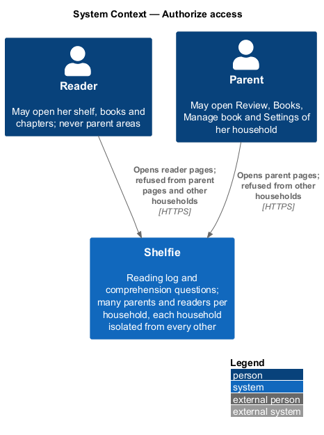
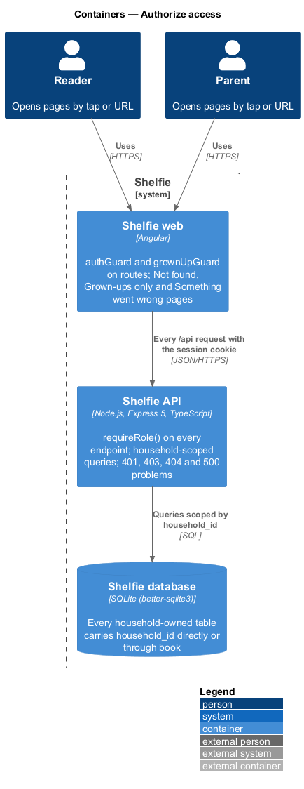
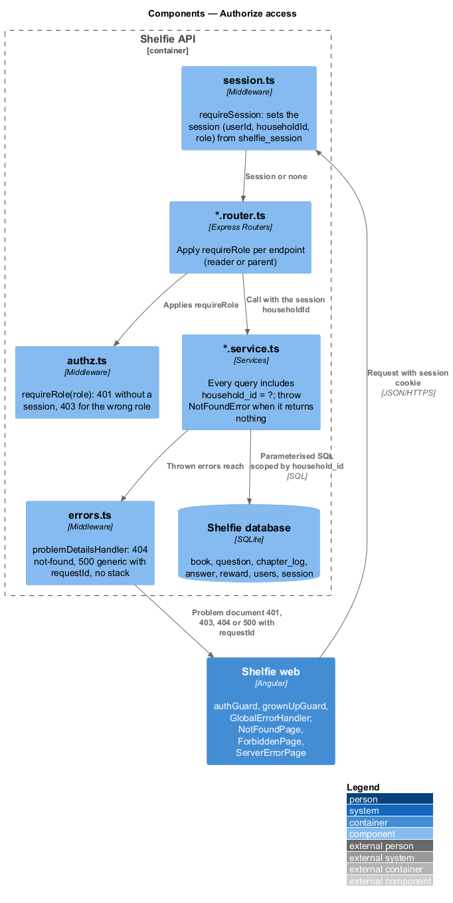
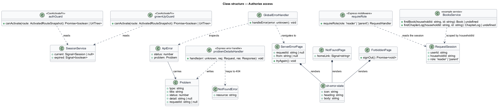
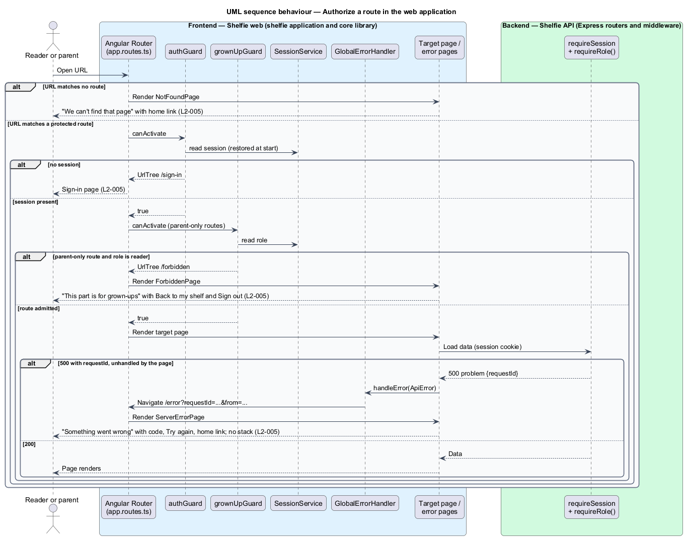
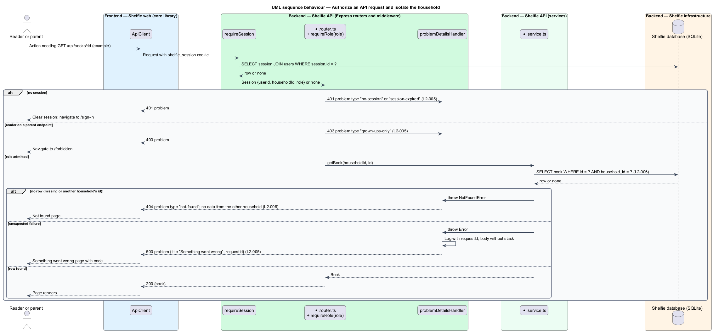

# Authorize access

## Overview

Shelfie is a web application that helps children read books by logging each chapter they read and answering short questions about it, while a parent in the same household reviews the answers and gives rewards. A **household** is the unit of tenancy: any number of parents and readers sharing one bookshelf. Only parents hold accounts; a parent adds each reader.

Two roles share one application, and households never see each other. This feature is the set of rules that keeps those boundaries. **Authorisation** decides, for each page and each API request, whether the current session may proceed. A request without a session is refused with `401` and the application returns to sign-in. A request from a reader for a parent area (Review, Books, Manage book, Settings) is refused with `403` and the application shows the **Grown-ups only** page. Every parent of a household may open the parent areas. An address that matches no page shows the **Not found** page with a link home. An unexpected failure inside the API answers `500` with a generic problem and a **request id**, and the application shows the **Something went wrong** page with a retry action and that id, never a stack trace.

**Household isolation** is the second half of the rule: every row a person can reach belongs to their own household, however many parents and readers it holds. Every query is scoped by `household_id`, so an id that belongs to another household is indistinguishable from an id that does not exist, and both answer `404`. The API never answers `403` for a foreign id, because a `403` would confirm that the id exists. A reader session is bound to the same rule: a chapter of a book outside her household is refused.

The feature sits in the `sign-in` subsystem beside password sign-in, sign-up, invite acceptance, session management and password reset. Every other feature relies on it: the guards on the routes, `requireRole()` on the endpoints and the household scope in the queries.

## Description

The slice has a frontend half (route guards and three error pages) and a backend half (the session and role guards, the error mapping and the query convention). The mock for the forbidden page is `docs/mocks/pages/forbidden/`. The code under `apps/` still names the roles `reader` and `grown_up` and the table `profile`; the design uses the role `parent` and the table `users`.

- **`authGuard`** — `CanActivateFn` in the `core` library. It allows the route when `SessionService` holds a session and otherwise redirects to `/sign-in`, adding `reason=expired` when the API reported an expired session (`L2-005`). `restore()` settles at application start before the first guard runs.
- **`grownUpGuard`** — `CanActivateFn` in the `core` library applied after `authGuard` on `/review`, `/review/**`, `/books`, `/books/:id/manage` and `/settings`. A `reader` session is redirected to `/forbidden` (`L2-005`). The name keeps the page name; it admits a `parent`.
- **`app.routes.ts`** — in the `shelfie` application: protected routes carry the guards; `/forbidden`, `/error` and the wildcard `**` route to the three pages below.
- **`NotFoundPage`**, **`ForbiddenPage`**, **`ServerErrorPage`** — page components in the `sign-in` library, each one `sh-error-state` inside the shell with the top bar of the current role. Not found: "We can't find that page" with a home link, Back to my shelf for the reader or Go to Review for the parent. Grown-ups only: "This part is for grown-ups" with Back to my shelf and Sign out. Something went wrong: "Something went wrong on our side" naming the request id as "code SHF-…", a Try again action that navigates to the URL that failed, and the role's home link.
- **`sh-error-state`** — component in the `components` library: large icon, heading, body and an actions slot; used by every page's `error` state as well.
- **`GlobalErrorHandler`** — Angular `ErrorHandler` in the `core` library. When an unhandled `ApiError` has status `500` or higher, or a route resolver throws, it navigates to `/error?requestId=<id>&from=<url>`; pages that catch their own load failure keep their inline `error` state instead.
- **`ApiClient`** — maps responses to `ApiError{status, problem}`; a `401` clears the session and navigates to sign-in (manage-session); a `403` navigates to `/forbidden`; a `404` is thrown to the page, which shows the Not found page for a missing book or chapter.
- **`requireSession`** (`session.ts`) — Express middleware that puts the session (`userId`, `householdId`, `role`) on `res.locals`, or answers `401` with problem type `no-session` or `session-expired`.
- **`requireRole(role)`** (`authz.ts`) — Express middleware used after `requireSession`. With a `reader` session on a `parent` route it answers `403` with type `grown-ups-only`. A route open to both roles uses `requireRole('reader')`, which admits readers and parents; a parent-only route uses `requireRole('parent')`.
- **`problemDetailsHandler`** (`errors.ts`) — maps `NotFoundError` to `404` type `not-found`, and any other thrown error to `500` with `title: "Something went wrong"` and the `requestId`, logging the error with that id and never the stack in the body (`L2-005`).
- **Query convention** — every service function that reads or writes a household-owned row takes `householdId` from the session and includes `household_id = ?` in the statement, joining through `book` for `question`, `chapter_log`, `answer` and `reward`. A miss returns `undefined`, and the service throws `NotFoundError`; a foreign id therefore answers `404` with no data (`L2-006`). A reader asking for a chapter of a book outside her household follows the same path.
- **Acceptance fixture** — the Playwright setup seeds two households, each with two parents and two readers, so the isolation tests can request the second household's book, chapter and reward ids from a parent session and a reader session of the first. The count of seeded users is `<TO SUPPLY>`.

Access among members of one household is not restricted beyond role: any parent reaches the household's parent areas and data. Whether a reader sees only her own logged chapters or the whole household's is not set by `L2-005` or `L2-006` (`<TO SUPPLY>`).

The forbidden mock notes that the same page could serve a parent who opens another household's link, with the copy "That book belongs to another family". The API answers `404` for a foreign id (`L2-006`), so the web shows the Not found page, whose copy already allows for a removed book, and that variant is not built.

## Requirements

The feature realizes the following level-2 (L2) requirements. Each refines a level-1 (L1) requirement, cited by identifier.

| L2 ID | Refines (L1) | Requirement |
|-------|--------------|-------------|
| `L2-005` | `L1-002` | Given no session, when any protected page or API is requested, then the user is sent to sign-in and the API returns 401. Given a reader session, when a parent area (Review, Books, Manage book or Settings) is opened by URL, then the "Grown-ups only" page is shown and the API returns 403. Given an unknown URL, when opened, then the Not found page is shown with a link home. Given an unexpected server failure, when a page loads, then the Something went wrong page is shown with a retry action and no stack trace. |
| `L2-006` | `L1-002` | Given two households, when household A requests an id belonging to household B, then the response is 404 and no data from B is returned. Given a reader session, when she requests a chapter of a book that is not in her household, then it is refused. |

## Diagrams

### System context

Parents and readers are authorised by Shelfie on every page and request; other households exist only as something they can never reach.

### Containers

Route guards in the Angular application decide what renders; `requireRole()` and household-scoped queries in the Express API decide what the SQLite database returns.

### Components

Inside the API, `requireSession` resolves the session, `requireRole()` refuses with `401` or `403`, services scope every query by `household_id`, and `problemDetailsHandler` turns misses and failures into `404` and `500` problems.

### Class structure

The guards and `GlobalErrorHandler` read `SessionService` and route to the three pages; on the backend `requireRole` reads the session and the queries take `householdId`.

### Behaviour — authorise a route in the web application

Opening a URL runs `authGuard` and `grownUpGuard`; the alternatives show sign-in, Grown-ups only, Not found and Something went wrong (`L2-005`).

### Behaviour — authorise an API request and isolate the household

The API refuses missing sessions and wrong roles, scopes the query by household, and answers `404` for a foreign id and `500` with a request id for an unexpected failure (`L2-005`, `L2-006`).

