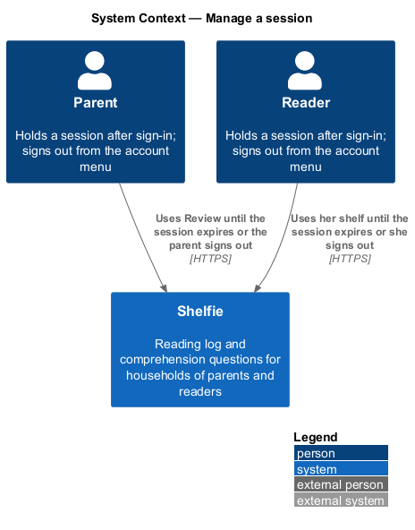
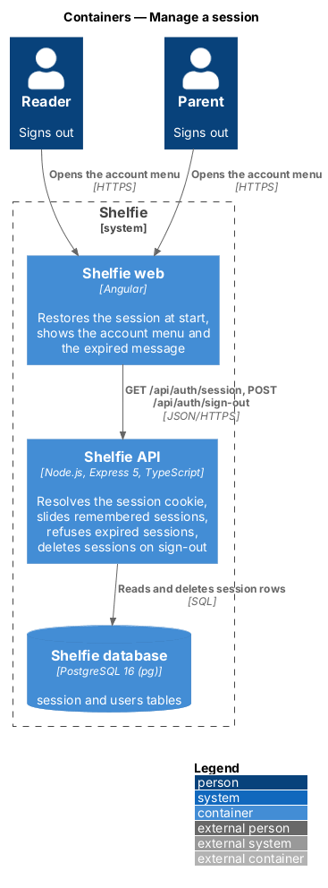
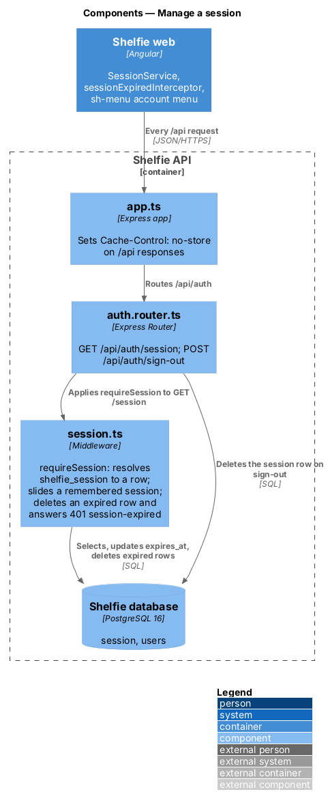
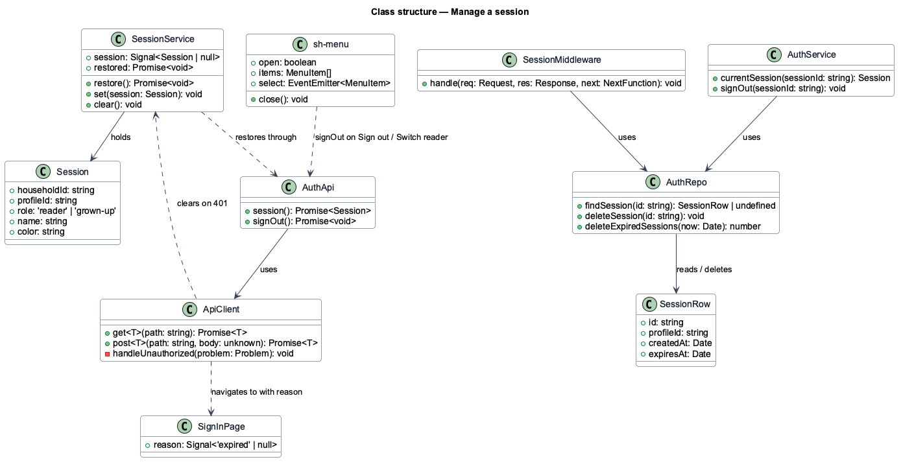
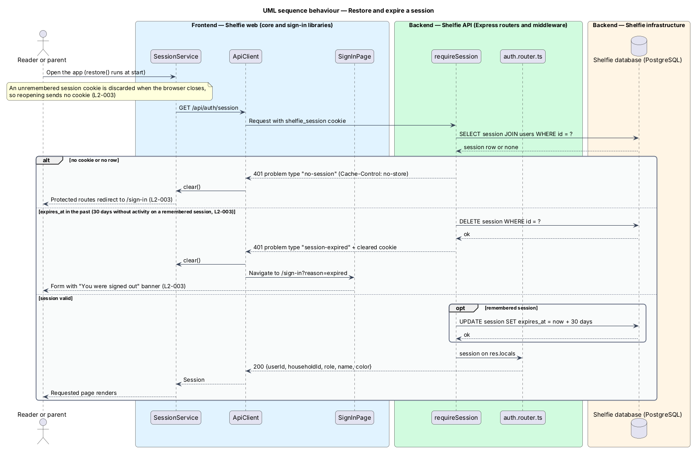
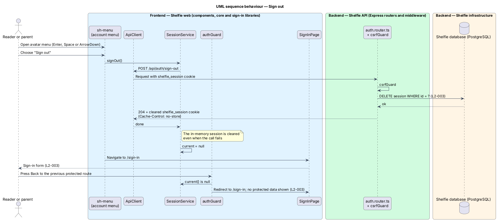

# Manage a session

## Overview

Shelfie is a web application that helps children read books by logging each chapter they read and answering short questions about it, while a parent in the same household reviews the answers and gives rewards. A **household** is the unit of tenancy: any number of parents and readers sharing one bookshelf. Only parents hold accounts; a parent adds each reader, who signs in with a username and password like the parent does.

A **session** is the record that a person has signed in: a server-side row in the `session` table, referenced by the HttpOnly cookie `shelfie_session`, holding the user it belongs to, whether "Remember me" was checked, and the time it expires. Sign-in creates one; this feature covers everything that happens to it afterwards.

The sign-in form offers **Remember me** (labelled "Keep me signed in" in the mock). The checkbox sets the lifetime of the session:

- A **remembered session** has an **idle timeout** of 30 days: each authenticated request moves `expires_at` to 30 days from now, and a session with no activity for 30 days expires. Closing and reopening the browser within that time leaves the person signed in.
- An **unremembered session** ends with the browser. Reopening the browser shows the sign-in page and no protected data.

Once a session has expired, the next action the person takes is refused by the API and the application returns to the sign-in page with the message "You were signed out", so nobody wonders why the page vanished.

The **account menu** opens from the avatar in the top bar. The reader's menu offers "Sign out"; the parent's menu adds "Settings". Sign-out ends the session on the server and returns to the sign-in page. After signing out, pressing the browser's Back button shows no protected data: the application holds no session in memory, every protected route redirects to sign-in, and API responses are marked not to be cached.

On every application start the web application asks the API whether a session exists, so that a returning person lands on the page requested without signing in again, and an absent or expired session is discovered before any protected page renders.

The feature sits in the `sign-in` subsystem beside password sign-in, sign-up, invite acceptance, password reset and route authorisation.

## Description

The slice runs from the account menu and the application start-up to the `session` table. The mocks are `docs/mocks/pages/sign-in/` (`expired` state) and `docs/mocks/dialogs/account-menu/` (`default` for the reader, `parent` for the parent). The code under `apps/` still implements the earlier profile model (`profile` table, separate reader and parent sign-in); the names below follow the current code where the behaviour is unchanged and the new model where it is not.

- **`SessionService`** — service in the `core` library holding the current session as a signal (`userId`, `householdId`, `role`, `name`, `color`). `restore()` runs once at application start, calls `GET /api/auth/session` and sets the signal or leaves it `null`. `signOut()` posts to `/api/auth/sign-out` and sets the signal to `null` whether or not the call succeeds. An `expired` signal records that the API reported an expired session, so that sign-in can say why. Route guards (authorize-access) read the signal after `restore()` has settled.
- **`sessionExpiredInterceptor`** — HTTP interceptor in the `core` library. On a `401` whose problem `type` is `session-expired` it clears `SessionService`, sets `expired` and navigates to `/sign-in?reason=expired`; `authGuard` redirects with the same reason when `expired` is set.
- **`SignInPage`** — when the route carries `reason=expired` it renders the `expired` state: an `sh-banner` above the form with "You were signed out" and "Sign in to carry on." followed by the form as usual, including the Remember me checkbox.
- **`sh-menu`** — component in the `components` library: a popover list of `menuitem` entries anchored to a trigger. It opens on Enter, Space or ArrowDown, moves with the arrow keys, closes on Escape and returns focus to the trigger. The account menu is the `sh-menu` that `sh-top-bar` (shell subsystem) opens from the avatar; its header shows the user's name and `@username`, with the streak for a reader and the role "parent" for a parent. Items: Settings (parent only, navigates to `/settings`) and Sign out.
- **`requireSession`** (`session.ts`) — Express middleware that reads `shelfie_session` and loads the row. When `expires_at` is in the past it deletes the row, clears the cookie and answers `401` with `type: "session-expired"`; with no cookie or no row it answers `401` with `type: "no-session"`. Otherwise it puts the session on `res.locals`. For a remembered session it moves `expires_at` to now plus `SESSION_DAYS` (30). An unremembered session row follows the same 30-day idle rule on the server; only its cookie differs (no `Max-Age`), so the browser drops it when it closes.
- **`auth.router.ts`** — `GET /api/auth/session` returns the summary of the current user. `POST /api/auth/sign-out` deletes the session row, clears the `shelfie_session` cookie and answers `204`.
- **Session cookie** — set by sign-in (password sign-in design). A remembered session carries `Max-Age` of 30 days; an unremembered session carries no `Max-Age`, so the browser discards it when it closes. Both are `HttpOnly`, `Secure` and `SameSite=Strict`. The current code always sets a 30-day `maxAge` and has no remember flag; adding it is part of the implementation of this design.
- **`app.ts`** — sets `Cache-Control: no-store` on `/api` responses, so Back after sign-out cannot replay a protected response from the browser cache (`L2-003`).
- **`session`** table: `id`, `user_id`, `created_at`, `expires_at`, plus the flag `remember` (1 or 0). Expired rows are deleted when met; there is no periodic sweep.

The `expired` message and the no-store header together satisfy the two user-visible promises: the person is told why they were signed out, and nothing protected remains on screen afterwards.

## Requirements

The feature realizes the following level-2 (L2) requirements. Each refines a level-1 (L1) requirement, cited by identifier.

| L2 ID | Refines (L1) | Requirement |
|-------|--------------|-------------|
| `L2-003` | `L1-001` | The sign-in form offers "Remember me". A remembered session lasts while the person is active; an unremembered session ends with the browser. Sessions expire and the person is told why. Given "Remember me" checked at sign-in, when the browser is closed and reopened within 30 days, then the person is still signed in. Given "Remember me" checked, when 30 days pass with no activity, then the next action sends the person to sign-in showing the "expired" message. Given "Remember me" unchecked, when the browser is closed and reopened, then the sign-in page is shown and no protected data is displayed. Given a person signs out, when they press Back, then no protected data is displayed. Given sign-out, when completed, then the server session is invalidated. |

## Diagrams

### System context

Parents and readers both hold sessions in Shelfie and end them from the account menu; the expiry is Shelfie's own rule.

### Containers

The Angular application restores, uses and ends the session through the Express API, which keeps the session rows in the PostgreSQL database.

### Components

Inside the API, `requireSession` resolves the cookie to a row on every protected request, the auth router exposes the session and sign-out endpoints, and the session table holds the rows.

### Class structure

`SessionService` and the expiry interceptor in the `core` library cooperate on expiry; `sh-menu` hosts the Sign out item; the backend middleware and router share the `session` table.

### Behaviour — restore and expire a session

At application start the session is restored from the cookie. A browser restart without "Remember me" leaves no cookie, so sign-in shows. A later action against an expired remembered session is refused, the row is deleted and the sign-in page shows the expired message (`L2-003`).

### Behaviour — sign out

The Sign out item deletes the server session, clears the in-memory session and returns to sign-in; Back afterwards hits the route guard and finds nothing to show (`L2-003`).

