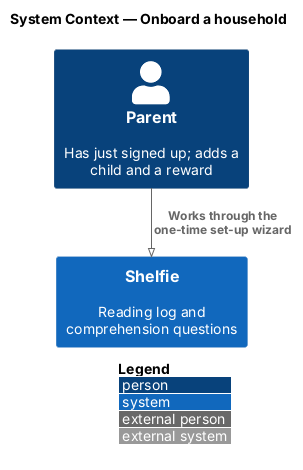
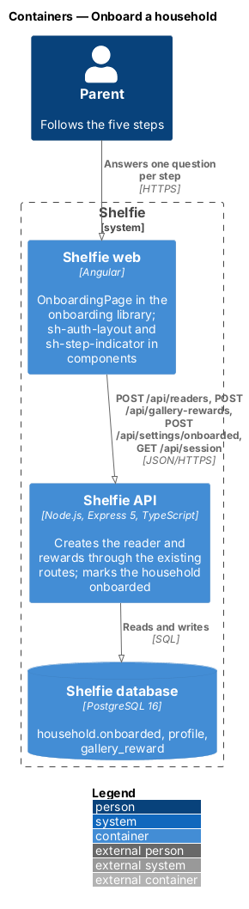
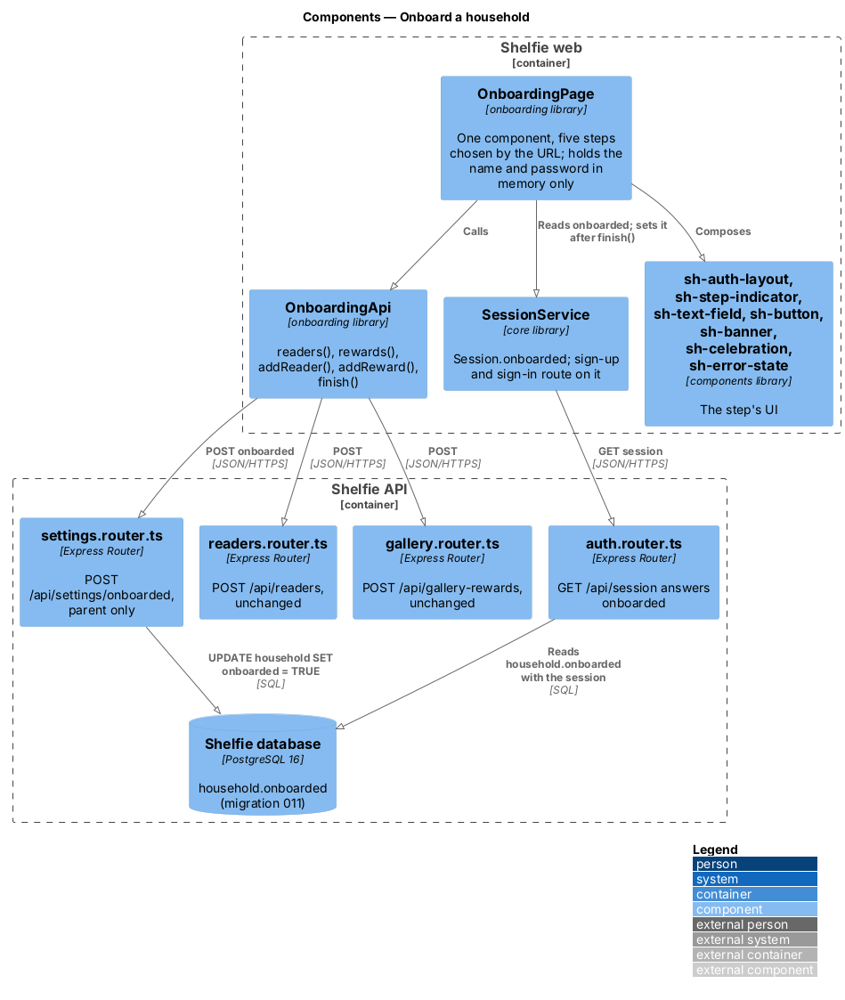
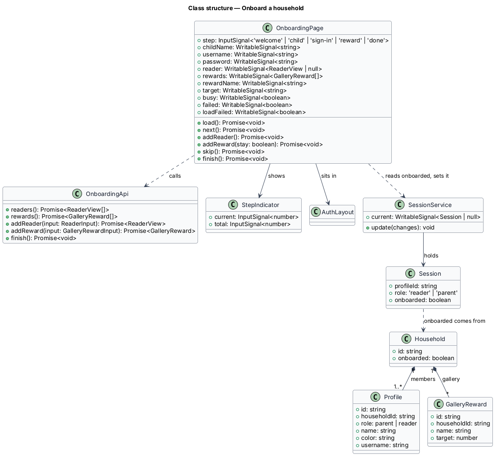
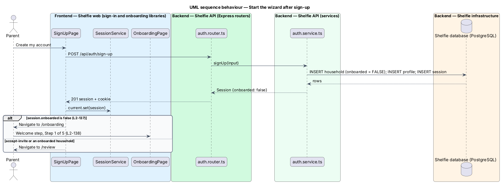
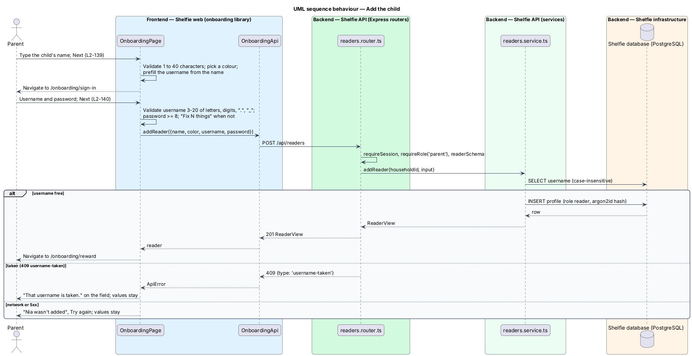
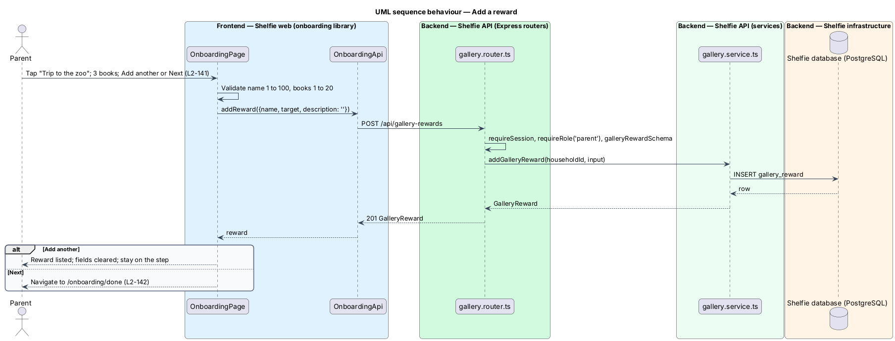
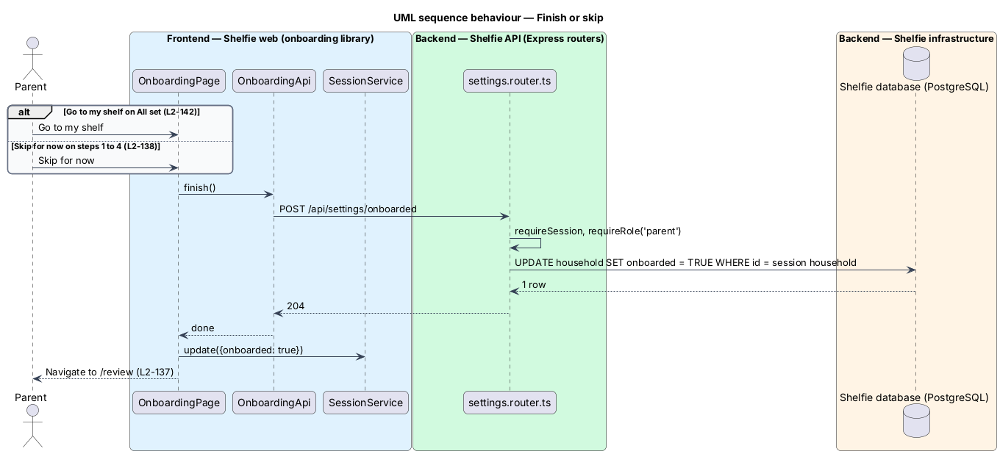
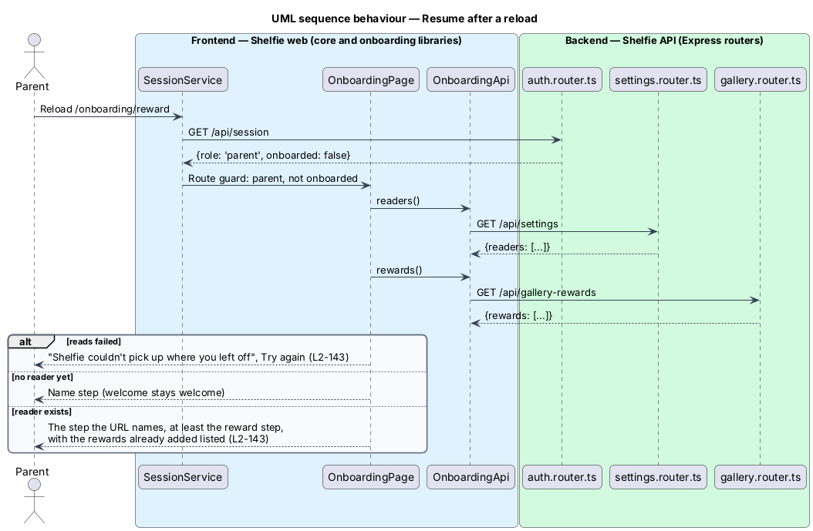

# Onboard a household

## Overview

Shelfie is a web application that helps a child read books by logging each chapter she reads and answering short questions about it, while a parent reviews her answers and gives rewards. A **household** is the unit of tenancy: parents and readers sharing one bookshelf. A **parent** holds an account; a **reader** is a child profile a parent creates. A household starts empty: the parent who signs up (sign-in/sign-up, `L2-033`) is its only member, and until now the first thing that parent saw was Review's empty state, with the child and the rewards still to be set up from Settings.

The **set-up wizard** replaces that landing for a new household only. It is a one-time flow of five full-screen steps, one purpose each: a welcome, the child's name, how the child signs in, a reward to read toward, and All set with the child's sign-in details shown once. Each step is one question, one or two fields and one button, with a step indicator, a Back where it makes sense and "Skip for now". The wizard creates the reader and the rewards through the same API routes and rules as Settings (settings/manage-readers, `L2-036`; review/reward-gallery, `L2-081`), so everything it creates can be changed there afterwards.

Whether the wizard is done is a flag on the household, so it runs once per household on whichever device the parent uses and never again after it is finished or skipped. Households that existed before the wizard shipped are migrated as done; a parent who joins by invite (sign-in/accept-invite, `L2-035`) joins a household that is already done. Readers never see it.

The feature sits in the `sign-in` subsystem, where sign-up hands over to it. Its page lives in a new `onboarding` feature library.

## Description

The slice runs from one page in the `onboarding` library, through the existing reader and gallery routes and one new route, to the `household` table.

- **Migration `011-onboarding.sql`** — adds `household.onboarded BOOLEAN NOT NULL DEFAULT TRUE`. Every household that exists when the migration runs, and every household created by any path other than sign-up (the seed, the SQLite import), is therefore done. `signUp` in `auth.service.ts` inserts the new household with `onboarded = FALSE`.
- **`GET /api/session`** (`auth.router.ts`) — the session row read by `requireSession` and built by `createSession` gains `onboarded`, read from the household, and the session summary carries it to the web app. `Session` in the `core` library gains `onboarded: boolean`.
- **`POST /api/settings/onboarded`** (`settings.router.ts`) — under the router's existing `requireSession` and `requireRole('parent')`, sets `onboarded = TRUE` on the caller's own household and answers `204`. It is the only write; there is no way to set the flag back.
- **`SignUpPage`** (`sign-in` library) — after a successful sign-up navigates to `/onboarding` when the session says `onboarded` is false, and to `/review` otherwise. `SignInPage` and `signedOutGuard` (`core`) do the same for a parent, so a household whose wizard is pending opens it on any device (`L2-137`). `AcceptInvitePage` is unchanged: the household it joins is done.
- **`AuthLayout`** (`sh-auth-layout`) — moved from the `sign-in` library to the `components` library without change, because the `onboarding` library composes it and feature libraries depend only on `components` and `core`. The five auth pages import it from `components`.
- **`StepIndicator`** (`sh-step-indicator`, `components` library) — `current` and `total` inputs; draws the dots and "Step N of M" (design system, Step indicator).
- **`OnboardingPage`** (`onboarding` library) — one component at `/onboarding`, `/onboarding/child`, `/onboarding/sign-in`, `/onboarding/reward` and `/onboarding/done`, the step bound from the route. It holds the child's name, username and password in signals only: nothing is written to browser storage, and the password is shown on no step but All set (`L2-142`). On load it reads the household's readers (`GET /api/settings`) and gallery (`GET /api/gallery-rewards`) and applies the resume rules of `L2-143`: no reader → the name step for any URL past it, and the name step for the sign-in step (the name is not kept); a reader → at least the reward step. The welcome step stays the welcome. A failed read shows `sh-error-state` with Try again. The steps:
  - **Welcome** — "Let’s go" navigates to the name step. "Skip for now" calls `finish()` and navigates to `/review` (`L2-138`).
  - **Child's name** — one `sh-text-field`. Next validates 1 to 40 characters, picks the avatar colour from the five reader colours (by the name's length, so it is stable across a reload) and prefills the username: the name lower-cased, characters other than letters, digits, "." and "_" dropped, cut to 20, left empty under 3 (`L2-139`).
  - **Child's sign-in** — username and password `sh-text-field`s with the same client checks and wording as `EditReaderDialog`; Next calls `POST /api/readers` with name, colour, username and password. `409 username-taken` puts "That username is taken." on the field; a network or server failure shows "{name} wasn’t added" with Try again; values stay (`L2-140`).
  - **Reward** — three example chips that fill "The reward", the reward and "Books to finish" fields with `GalleryRewardDialog`'s checks, an empty description. "Add another" calls `POST /api/gallery-rewards`, lists the reward and clears the fields; Next saves when the fields hold a reward, then navigates to All set; with the fields empty and a reward already listed it only navigates (`L2-141`).
  - **All set** — `sh-celebration` with the username and, while it is in memory, the password. "Go to my shelf" calls `finish()`, updates `SessionService`, and navigates to `/review` (`L2-142`). After a reload the password line says it is the one chosen.
- **`OnboardingApi`** (`onboarding` library, on `ApiClient`) — `readers()`, `rewards()`, `addReader(input)`, `addReward(input)` and `finish()`, each one call to the routes above.
- **Route** — `onboarding` and `onboarding/:step` in the application's routes, `canActivate: [authGuard, grownUpGuard]`, lazy-loading `OnboardingPage`. A reader is sent to the grown-ups-only page (`L2-005`). The page itself navigates to `/review` when the session is already onboarded.
- **Illustrations** — five static SVGs in `components/src/assets/onboarding/`, served at `/onboarding/*.svg` by the application's asset rule, drawn in the stickers' style with pastel fills and a violet outline so they read in both themes.

Unchanged: Settings and its dialogs, `POST /api/readers` and `POST /api/gallery-rewards` and their validation, the sign-up form, invite acceptance, and everything a reader sees.

## Requirements

The feature realizes the following level-2 (L2) requirements. Each refines a level-1 (L1) requirement, cited by identifier.

| L2 ID | Refines (L1) | Requirement |
|-------|--------------|-------------|
| `L2-137` | `L1-029` | The set-up wizard runs once per new household. Given a parent completes sign-up, when the household is created, then the parent lands on the wizard's welcome step at `/onboarding` instead of Review. Given a parent accepts an invite into an existing household, when signed in, then Review opens and the wizard never shows for them. Given a household that existed before the wizard shipped, when any of its parents signs in, then Review opens and the wizard never shows. Given a household whose wizard has been neither finished nor skipped, when a parent of that household signs in on any device, then the wizard opens at its welcome step. Given the wizard was finished or skipped, when a parent of the household opens `/onboarding` or any step's URL on any device, then Review opens instead. Given a reader, when she opens `/onboarding`, then the grown-ups-only page shows. Given a signed-in parent, when the session is read, then it says whether the household's wizard is done; it is marked done only by one parent-only API call that affects the caller's own household. |
| `L2-138` | `L1-029` | Welcome step. Given the welcome step, when shown, then it has "Step 1 of 5", one illustration, "Let’s set up Shelfie for your family", a "Let’s go" button and a "Skip for now" link, and no shell navigation. Given "Let’s go", when pressed, then the child's name step opens at `/onboarding/child`. Given "Skip for now" on the welcome, child's name, sign-in or reward step, when pressed, then the wizard is marked done for the household and Review opens; anything already created stays. |
| `L2-139` | `L1-029` | Child's name step. Given the child's name step, when shown, then it has "Step 2 of 5", one field "Child’s name" with focus, "Next", "Back" and "Skip for now". Given a name of 1 to 40 characters after trimming, when Next is pressed, then the sign-in step opens with the username prefilled from the name and no request is sent. Given an empty name or one over 40 characters, when Next is pressed, then the field says so, keeps focus and no request is sent. Given "Back", when pressed, then the welcome step opens. Given the reader is created later, then her avatar colour is one of the five reader colours chosen by the wizard, and a parent can change it in Settings. |
| `L2-140` | `L1-029` | Child's sign-in step creates the reader. Given the sign-in step, when shown, then it has "Step 3 of 5", "Username" with its help and the prefilled value, "Password" with its help, "Next", "Back" and "Skip for now". Given a valid username and a password of at least 8 characters, when Next is pressed, then the reader is created with the name, the chosen colour, the username and the password, and the reward step opens. Given an invalid username or short password, when Next is pressed, then a "Fix N things" summary and the field errors show and no request is sent. Given a taken username, when Next is pressed, then the field says "That username is taken.", the values stay and nothing is created. Given a request in flight, when Next is pressed again, then no second request is sent. Given a failure, when Next is pressed, then "Nia wasn’t added" with "Try again" shows and the values stay. Given "Back", when pressed, then the name step opens with the name still filled in. Given the reader was created, when the parent opens Settings, then she is listed with her username and can sign in. |
| `L2-141` | `L1-029` | Reward step. Given the reward step, when shown, then it has "Step 4 of 5", the examples, the fields "The reward" and "Books to finish", "Next", "Add another" and "Skip for now", and no Back. Given an example, when tapped, then "The reward" holds its text. Given a valid name and book count, when "Add another" is pressed, then the reward is added, listed, and the fields clear. Given the same, when Next is pressed, then the reward is added and All set opens. Given a reward listed and empty fields, when Next is pressed, then All set opens and nothing more is sent. Given no reward listed and empty or invalid fields, when Next or "Add another" is pressed, then a summary and the field errors show and no request is sent. Given a failure, then "{name} wasn’t added" with "Try again" shows and the values stay. Given rewards were added, when the parent opens Settings → Rewards, then each is listed. |
| `L2-142` | `L1-029` | All set step. Given the All set step, when shown, then it has "Step 5 of 5", a celebration, "All set!", the child's username and the password typed on the sign-in step, "Go to my shelf", and neither Back nor Skip. Given "Go to my shelf", when pressed, then the wizard is marked done and Review opens. Given the wizard was finished, when the parent opens Settings, then the reader and every reward are present. Given the password, then it is held only in the page's memory and shown on no step but this one. |
| `L2-143` | `L1-029` | Back and resume after a reload. Given a reload on the welcome, name or sign-in step while the household has no reader, then the welcome or name step opens as named by the URL, and a reload on the sign-in step opens the name step. Given a reload after the reader was created, then at least the reward step opens. Given a reload on the reward or All set step before a reader exists, then the name step opens. Given a reload on the reward step, then the rewards already added are listed. Given a reload on the All set step, then the username shows and the page says the password is the one chosen. Given the readers or rewards cannot be read, then an error state with "Try again" shows. Given the browser's Back button, then the previous step's URL opens under the same rules. |

## Decisions

- **The flag lives on the household, not in the browser.** Recorded in [ADR-0018](../../../adr/0018-onboarding-wizard-flag-and-reuse.md). `localStorage` would make the wizard once per browser and would show it again to a parent on a second device; the household flag makes it once per family and lets the migration mark every existing household done.
- **The existing reader and reward routes are reused as they are.** The wizard posts the same bodies as `EditReaderDialog` and `GalleryRewardDialog`, so one set of validation rules and one `username-taken` answer serve both. No wizard-specific create route exists (ADR-0018).
- **A full-screen page in the auth layout, not a dialog.** The parent has just left the sign-up card; a dialog over Review's empty state would mean the shell and Review load behind it only to be hidden. One step per URL also gives Back, reload and bookmarks for free (ADR-0018).
- **`sh-auth-layout` moves into `components`.** The `onboarding` library may depend only on `components` and `core`, and the layout was already listed as a catalogue candidate. The move changes imports in five pages and nothing else.
- **The step is in the URL; what it needs comes from the API.** No browser storage at all: the child's name is retyped after a reload on the sign-in step, which is the one place a reload loses a few seconds of typing, and the password can never leak into storage.
- **Skip for now always marks the wizard done.** One rule on every step that has it (`L2-138`); a parent who skips on the reward step has already seen and typed the password and can set a new one in Settings.
- **Sign-in also opens a pending wizard.** A parent who signs up on a phone and signs in on a laptop lands on the welcome step until the household is done, which is what "once per household on any device" means in practice. This is one line in `SignInPage` and `signedOutGuard`.

## Diagrams

### System context

A parent works through the wizard with Shelfie directly; no external system takes part.

### Containers

The onboarding page in the Angular application calls the existing reader and gallery routes and one new settings route; the session read carries the household's flag.

### Components

`OnboardingPage` composes the library components and calls `OnboardingApi`; on the API only `settings.router.ts` and the session read change, and the reader and gallery routers are untouched.

### Class structure

`OnboardingPage` keeps the step's values in signals, calls `OnboardingApi`, and reads and updates `Session.onboarded` through `SessionService`; the flag comes from `Household`.

### Behaviour — start the wizard after sign-up

Sign-up creates the household with `onboarded = FALSE`, the session says so, and the page navigates to the welcome step instead of Review; an invite or an onboarded household goes to Review (`L2-137`, `L2-138`).

### Behaviour — add the child

The name step validates and prefills; the sign-in step creates the reader through `POST /api/readers`, with the taken and failed alternates (`L2-139`, `L2-140`).

### Behaviour — add a reward

A reward is saved through `POST /api/gallery-rewards`; "Add another" stays and "Next" goes on (`L2-141`).

### Behaviour — finish or skip

"Go to my shelf" and "Skip for now" both call `POST /api/settings/onboarded`, update the session and open Review (`L2-137`, `L2-138`, `L2-142`).

### Behaviour — resume after a reload

The session read decides whether the wizard still applies; the readers and gallery reads decide which step the URL may show (`L2-143`).

## Open questions

- **What a reload keeps (resolved).** Only the URL. The child's name is not kept, so a reload on the sign-in step returns to the name step; keeping it in `sessionStorage` would be harmless but adds a second place state lives for a few seconds of typing. The password is never kept anywhere.
- **Skip on the reward step (resolved).** It marks the wizard done and opens Review, like every other Skip, rather than opening All set. One rule, and the parent has just typed the password.
- **Deferred.** More than one child in the wizard, streak rewards, reward pictures and descriptions, adding the first book, re-running the wizard from Settings and inviting the other parent from the wizard are not built; Settings does all of them.
