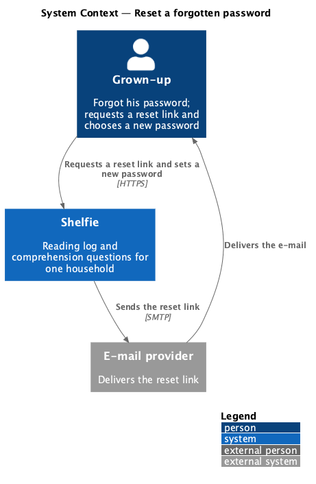
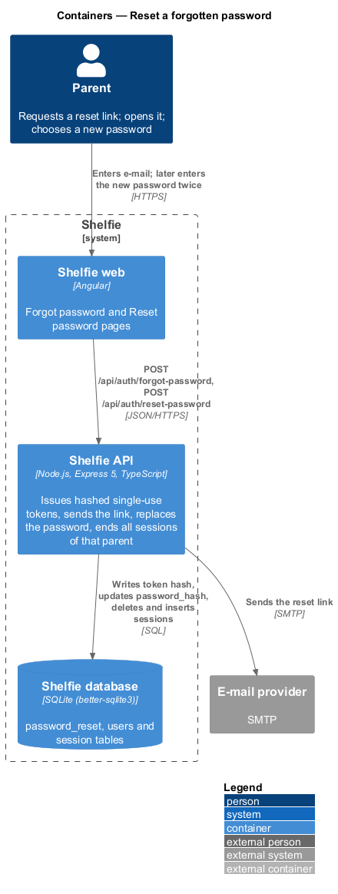
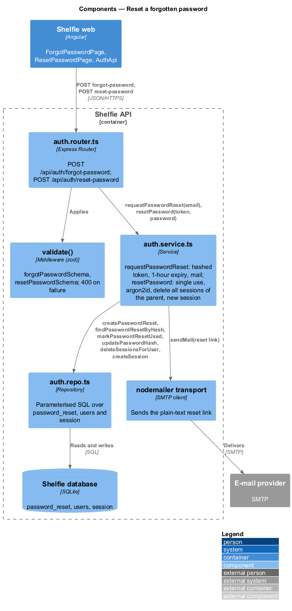
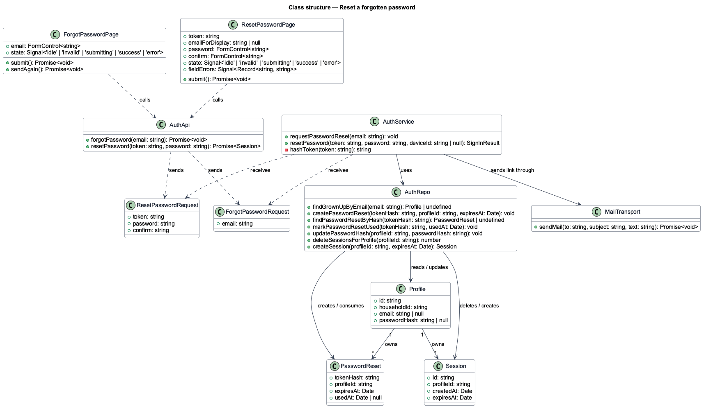
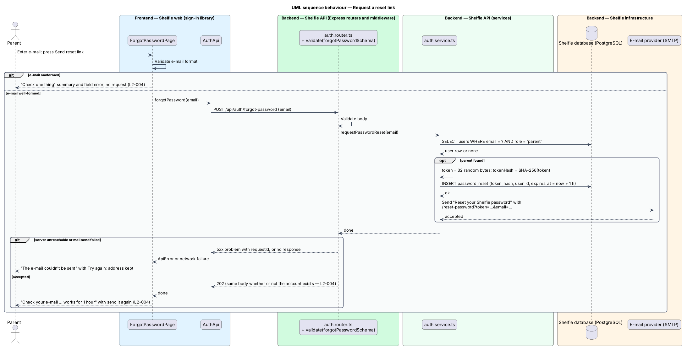
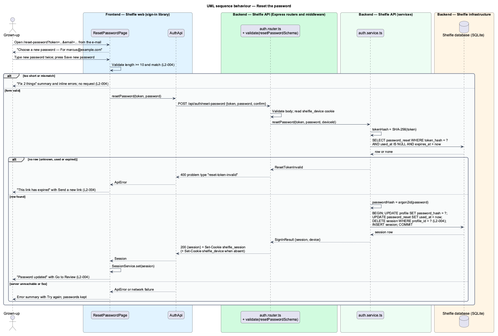

# Reset a forgotten password

## Overview

Shelfie is a web application that helps children read books by logging each chapter they read and answering short questions about it, while a parent in the same household reviews the answers and gives rewards. A **household** is the unit of tenancy: any number of parents and readers sharing one bookshelf. Only parents hold accounts. A parent signs in with a username and password, and each reader the parent adds does the same.

Only a parent has an e-mail address. A reader has none and cannot reset a password this way. Recovering a forgotten reader password is outside this feature (a parent sets a reader's password from the edit-reader dialog, manage-readers design).

When a parent forgets the password, this feature lets the parent choose a new one without anyone's help. The parent enters an e-mail address on the **Forgot password** page and Shelfie sends a **reset link** to that address through an external e-mail provider over SMTP. The link carries a **reset token**, a random secret that is valid for 1 hour and can be used once. Opening the link shows the **Reset password** page, where the parent types a new password of at least 8 characters twice. On success every existing session of that parent is ended, the parent is signed in on the device used, and Review opens. Sessions of other parents and of readers are untouched.

The Forgot password page gives the same answer whether or not the e-mail belongs to an account: "If marcus@example.com has a Shelfie account, a reset link is on its way." This keeps the page from confirming which addresses exist. The token itself is never stored; only its hash is, so a copy of the database does not yield working links.

The feature sits in the `sign-in` subsystem beside password sign-in, sign-up, invite acceptance, session management and route authorisation. It shares the mail transport with the invite-parent design. The production e-mail provider is deferred (AGENTS.md, Deferred work); locally the mail goes to Mailpit.

## Description

The slice runs from two pages in the sign-in library to the `password_reset`, `users` and `session` tables, with one call out to the e-mail provider. The mocks are `docs/mocks/pages/forgot-password/` and `docs/mocks/pages/reset-password/`. The code under `apps/` still implements the earlier profile model (`profile` table, e-mail sign-in). The names below follow the current code where the behaviour is unchanged and the new model (`users`, usernames, parents only) where it is not.

- **`ForgotPasswordPage`** — page component in the `sign-in` library at `/forgot-password`. One `sh-text-field` for the e-mail (autofocused), a Send reset link `sh-button` and a Back to sign in link. It owns the `default`, `invalid`, `submitting`, `success` and `error` states in the mock folder. A malformed e-mail shows the "Check one thing" summary and field error without sending. On success it shows "Check your e-mail" with the entered address, the 1-hour validity and a "send it again" link that resubmits. When the server does not answer it shows "The e-mail couldn't be sent" with Try again, keeping the address.
- **`ResetPasswordPage`** — page component in the `sign-in` library at `/reset-password`, opened from the e-mailed link `/reset-password?token=<token>&email=<address>`. The `email` parameter is display only ("For marcus@example.com"); the server reads only the token. Two `sh-text-field`s, New password (help text "At least 8 characters. A short sentence works well.") and Type it again, and a Save new password `sh-button`. Client-side validation enforces the 8-character minimum and equality, showing the "Fix 2 things" summary and inline errors. On a `reset-token-invalid` response it shows the `error` state "This link has expired" with a Send a new link action to `/forgot-password`. On success it shows "Password updated" with "You're signed in on this device. Other devices will ask for the new password next time." and Go to Review. No endpoint checks a token before submission, so the `error` state appears on submit.
- **`AuthApi`** — `forgotPassword(email)` posts to `/api/auth/forgot-password`; `resetPassword(token, password)` posts to `/api/auth/reset-password` and returns a `Session`.
- **`auth.router.ts`** — `POST /api/auth/forgot-password` validates with `forgotPasswordSchema` (`email`, e-mail format) and always answers `202` with an empty body. `POST /api/auth/reset-password` validates with `resetPasswordSchema` (`token`, and `password` of at least 8 characters) and answers `200` with the session summary and `Set-Cookie shelfie_session`. Both endpoints require no session. The page compares the two password fields; the API receives one.
- **`auth.service.ts`** — `requestPasswordReset(email)` finds the parent by e-mail. When found, it generates 32 random bytes, stores the SHA-256 hash of their base64url form in `password_reset` with `expires_at` = now + 1 hour, and sends the mail. When not found it returns without inserting or sending, and the router answers the same `202`. `resetPassword(token, password)` hashes the token and loads the matching row where `used_at IS NULL` and `expires_at` is in the future; otherwise it returns `null` and the router answers `400` with type `reset-token-invalid`. A valid token leads to one transaction that hashes the password, updates `users.password_hash`, sets `used_at`, deletes every session of that user (`L2-004`) and creates a new session. That new session is remembered.
- **Mail transport** — `mail.ts` sends plain text with the link, using `APP_URL` to build it. The token never appears in logs.
- **Tables** — `password_reset`: `token_hash`, `user_id`, `expires_at`, `used_at`. `users` columns used: `id`, `household_id`, `role`, `username`, `email`, `password_hash`. `session`: as in the manage-session design.

The mock's success state signs the parent in on the device and offers Go to Review. The design follows the mock, creating the new session after all existing sessions of that parent are deleted, so that the invalidation in criterion 5 holds for every other device.

## Requirements

The feature realizes the following level-2 (L2) requirements. Each refines a level-1 (L1) requirement, cited by identifier.

| L2 ID | Refines (L1) | Requirement |
|-------|--------------|-------------|
| `L2-004` | `L1-001` | A parent can request a reset link by e-mail and set a new password. Readers have no e-mail and cannot reset this way. Given any well-formed e-mail, when submitted on Forgot password, then the same success message is shown whether or not the account exists. Given a valid single-use reset link, when a new password of at least 8 characters is submitted twice identically, then the password changes and the parent is signed in on this device. Given a used or expired link, when opened, then an error state is shown with an option to request a new link. Given mismatching or too-short passwords, when submitted, then inline errors are shown. Given a reset completes, when finished, then all existing sessions of that parent are invalidated. |

## Diagrams

### System context

The parent asks Shelfie for a reset link; Shelfie hands the message to the external e-mail provider, which delivers it to the parent.

### Containers

The two pages in the Angular application post to the Express API, which stores the token hash in the SQLite database and sends the link over SMTP.

### Components

Inside the API, the auth router validates both bodies and delegates to `auth.service.ts`, which uses `auth.repo.ts` for the reset row, the password hash and the sessions, and the mail transport for delivery.

### Class structure

`ForgotPasswordPage` and `ResetPasswordPage` call `AuthApi`; the service creates and consumes `PasswordReset` rows and replaces the parent's `Session`s.

### Behaviour — request a reset link

The page validates the address, the API records a hashed token and sends the link when a parent has that e-mail, and the same success message is shown either way (`L2-004`).

### Behaviour — reset the password

The page enforces length and match, the API consumes the token once, replaces the hash, deletes every session of that parent and signs the parent in on this device; a used or expired token yields the error state (`L2-004`).

