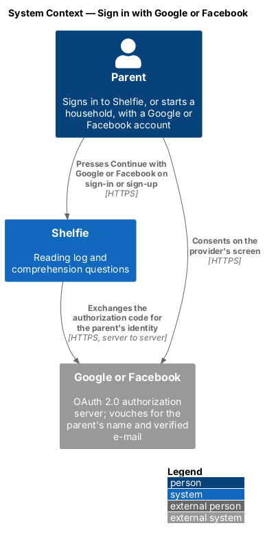
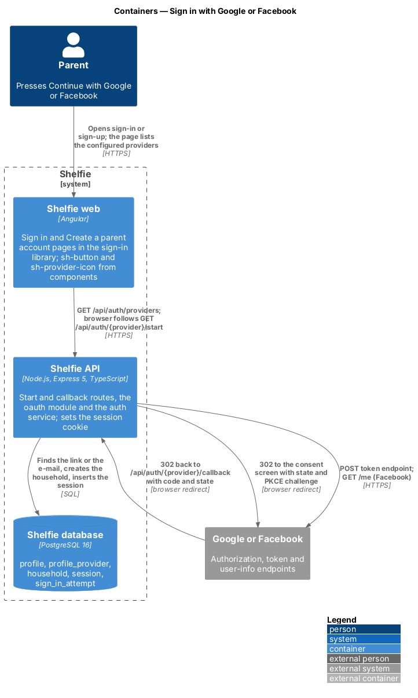
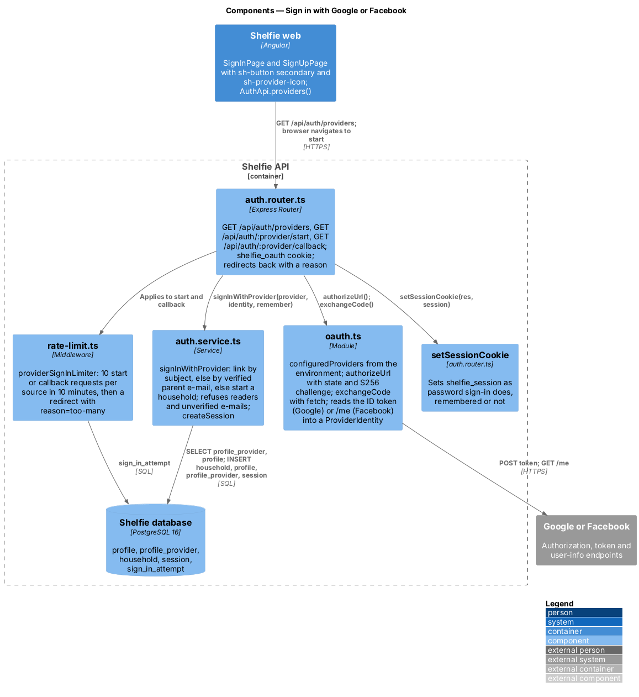
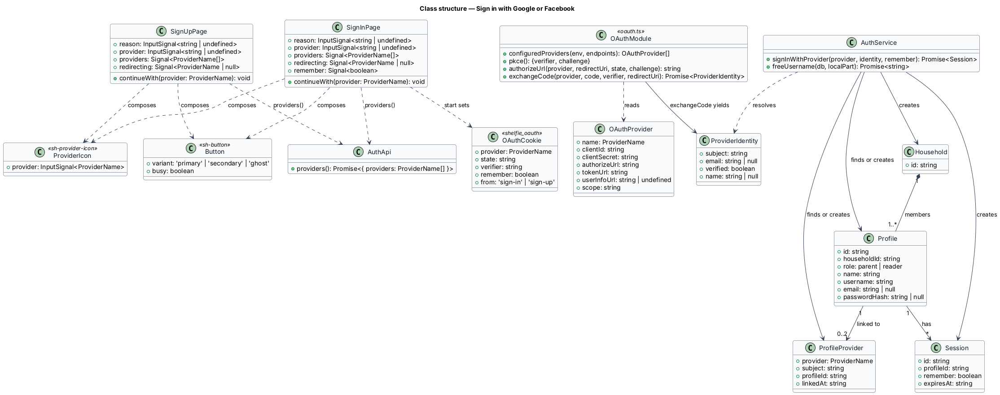
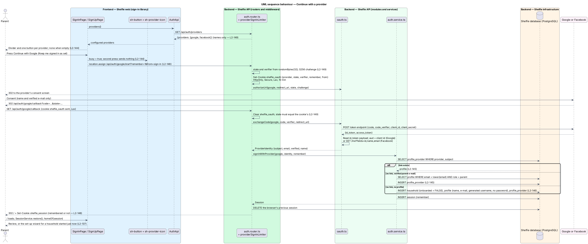
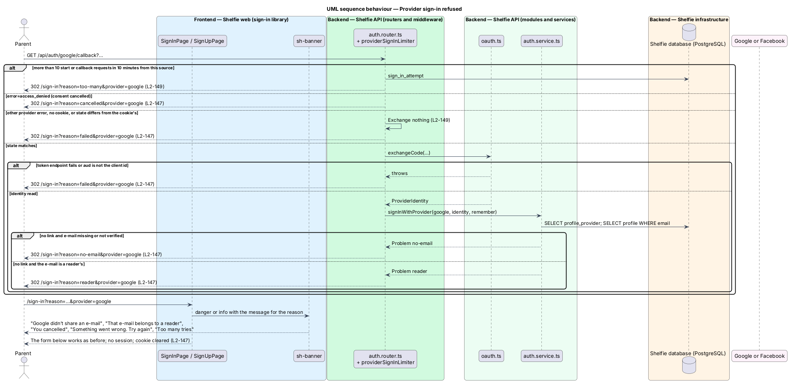

# Sign in with Google or Facebook

## Overview

Shelfie is a web application that helps children read books by logging each chapter they read and answering short questions about it, while a parent reviews the answers and gives rewards. A **household** is the unit of tenancy: any number of parents and readers sharing one bookshelf. Only parents hold accounts; a parent adds each reader, who signs in with a username and password.

This feature gives a parent a second way in. On the **Sign in** page and the **Create a parent account** page, below the password form, a parent presses **Continue with Google** or **Continue with Facebook**, consents at the provider, and comes back signed in. A **provider** is Google or Facebook acting as an OAuth 2.0 authorization server that vouches for the parent's name and e-mail address. Readers are unchanged: they sign in with a username and password only (`L1-001`), and the buttons are labelled for parents because readers see the same sign-in page.

Which account the parent lands in follows two rules, in order. A **provider link** is a stored pair of provider name and **subject id** (the provider's stable identifier for the account, `sub` for Google and `id` for Facebook) attached to a parent profile. When a link exists for the provider account, that parent is signed in, whatever e-mail the provider now reports. Otherwise the provider's **verified e-mail** is matched against parent profiles: a match signs that parent in and creates the link. No match starts a new household with a parent made from the provider's name and e-mail, as sign-up does (`L2-033`), and links it. Such a parent has no password and types no username; the account is reachable through the provider until the parent sets a password through Forgot password (`L2-004`).

A provider sign-in that cannot complete (an e-mail that belongs to a reader, no verified e-mail, a cancelled consent screen, a provider error, a `state` that does not match) returns the parent to the page they started from with a banner above the card that says what happened. Nothing is created, linked or signed in.

The flow is the plain OAuth 2.0 authorization-code flow with PKCE and a `state` value, run by the API with `fetch` and Node's `crypto`; no auth library and no provider SDK takes part ([ADR-0019](../../../adr/0019-sign-in-with-google-or-facebook-without-an-auth-library.md)). The browser only follows redirects. Provider tokens stay on the server and are discarded once the parent's identity has been read. The session the callback sets is the one password sign-in sets, so session lifetime (`manage-session`), route authorisation and sign-out are unchanged.

The feature sits in the `sign-in` subsystem beside password sign-in, sign-up, accept-invite, session management and password reset.

## Description

The slice runs from the two auth pages to the `profile`, `profile_provider`, `household` and `session` tables, through two redirects to the provider and back. The mock states are in `docs/mocks/pages/sign-in/` and `docs/mocks/pages/sign-up/`: `default`, `one-provider`, `no-providers`, `redirecting`, `provider-no-email`, `provider-reader`, `provider-cancelled` and `provider-failed`.

### Web

- **`SignInPage`** and **`SignUpPage`** — page components in the `sign-in` library. On init each asks `AuthApi.providers()` which providers are on and renders, below the form, a `divider` line ("Parents can also" on sign-in, "or" on sign-up) and one `sh-button` `secondary` block per configured provider (medium height, so the label fits a 360px phone), each with an `sh-provider-icon` before its label. With no provider configured, neither the line nor a button renders (`L2-144`). Pressing a button sets a `redirecting` signal (the button shows `busy`; a second press sends nothing) and sends the browser to `/api/auth/{provider}/start?remember={1|0}&from={sign-in|sign-up}` with `location.assign`; `remember` is the sign-in page's "Keep me signed in" switch, and `1` on sign-up, which has no switch (`L2-148`). Both pages take the query parameters `reason` and `provider` (router input binding, as `reason=expired` already is) and render the return banner above the card: `sh-banner` `danger` for `no-email` ("Google didn’t share an e-mail"), `reader` ("That e-mail belongs to a reader"), `failed` ("Something went wrong. Try again") and `too-many` ("Too many tries"); `info` for `cancelled` ("You cancelled"). The message names the provider from the `provider` parameter (`L2-147`).
- **`sh-provider-icon`** — component in the `components` library: the Google or Facebook brand mark (`provider: 'google' | 'facebook'`), an inline SVG with the class `icon icon--brand`, `aria-hidden`. The marks are the only filled icons in the set and carry the brands' own colours (design system, Iconography).
- **`sh-button`** — gains the `secondary` variant (the plain `.btn`), which the provider buttons use.
- **`AuthApi.providers()`** — `GET /api/auth/providers`, returning `{ providers: ('google' | 'facebook')[] }`.

### API

- **`GET /api/auth/providers`** — answers the names of the providers whose client id and secret are set. No session is needed. Secrets never leave the server (`L2-149`).
- **`GET /api/auth/:provider/start`** — behind `providerSignInLimiter`. Validates `provider` against the configured set and `from` against `sign-in` or `sign-up`. Draws a 32-byte `state` and a 32-byte PKCE **code verifier** with `randomBytes`, derives the S256 `code_challenge`, and sets the cookie `shelfie_oauth` (HttpOnly, Secure, SameSite=Lax, path `/api/auth`, 10 minutes) holding `{ provider, state, verifier, remember, from }`. Lax, not Strict, because the provider's redirect back is a cross-site top-level navigation. Then answers `302` to the provider's authorization endpoint with `client_id`, `redirect_uri` (`${APP_URL}/api/auth/{provider}/callback`), `response_type=code`, `scope`, `state`, `code_challenge` and `code_challenge_method=S256` (`L2-149`).
- **`GET /api/auth/:provider/callback`** — behind the same limiter. Reads and clears `shelfie_oauth`. With no cookie, a cookie for another provider, or a `state` that differs from the query's, it returns the parent with `reason=failed` and exchanges nothing. With `error=access_denied` it returns with `cancelled`; any other `error` with `failed`. Otherwise it calls `signInWithProvider` and, on success, ends the browser's previous session, sets `shelfie_session` as `setSessionCookie` does for a password sign-in (remembered or not from the cookie's `remember`) and answers `302` to `/`, which the web application resolves to the parent's home through `homeOf`: Review, or the set-up wizard for a household started just now (onboard-household). A `Problem` from the service becomes `302` to `/{from}?reason={type}&provider={provider}`.
- **`providerSignInLimiter`** (`rate-limit.ts`) — `rateLimiter` over `sign_in_attempt` with the key `provider:{ip}` and the password limiter's budget (10 in 10 minutes). `rateLimiter` takes a `limited` handler for the refused request; the provider limiter's handler redirects to `/{from}?reason=too-many&provider={provider}` instead of answering `429` JSON to a navigating browser (`L2-149`).
- **`oauth.ts`** — the provider table and the flow's pure parts. `OAuthProvider` is `{ name, clientId, clientSecret, authorizeUrl, tokenUrl, userInfoUrl, scope }`. `configuredProviders(env, endpoints?)` builds the list from `GOOGLE_CLIENT_ID`, `GOOGLE_CLIENT_SECRET`, `FACEBOOK_CLIENT_ID` and `FACEBOOK_CLIENT_SECRET`; a provider with either value missing is left out. `authorizeUrl(provider, redirectUri, state, challenge)` builds the redirect. `exchangeCode(provider, code, verifier, redirectUri)` posts to the token endpoint with `fetch` and returns `ProviderIdentity = { subject, email, verified, name }`:
  - **Google** (OpenID Connect): scope `openid email profile`; the token response's `id_token` is split and its payload decoded; `aud` must equal the client id; `sub`, `email`, `email_verified` and `name` are read. The token came straight from Google's token endpoint over TLS, so its signature is not verified (ADR-0019).
  - **Facebook** (Graph API): scope `email public_profile`; the access token is sent to `/me?fields=id,name,email`; `id` and `name` are read; `email` is present only when Facebook has verified it, so `verified` is `email !== undefined`.
  - The endpoints default to the real providers and can be overridden, so the tests point both providers at a stand-in (`L2-149`).
- **`auth.service.ts`** — `signInWithProvider(pool, provider, identity, remember)`: finds `profile_provider` by `(provider, subject)` and signs that profile in when found; else refuses with `Problem(400, 'no-email')` when `email` is missing or `verified` is false; else loads the profile by lower-cased e-mail: a reader refuses with `Problem(403, 'reader')`, a parent is linked and signed in; no profile starts a household in one transaction (`household` with `onboarded = FALSE`, as sign-up does, so the set-up wizard runs once; `profile` with role `parent`; `profile_provider`; `session`) and signs the new parent in. The new profile's `name` is the provider's name trimmed to 40 characters, or the e-mail's local part when the provider sends none; its `username` comes from `freeUsername(db, localPart)`: the e-mail's local part lower-cased, stripped to `[a-z0-9._]`, cut to 20, padded with `_` to 3, and given a numeric suffix until no profile holds it, ignoring case; its `password_hash` is null (`L2-146`). Linking, signing in and creating all run through the existing `createSession`.
- **`profile_provider`** table (migration `012-profile-provider.sql`): `provider TEXT` (`google` or `facebook`), `subject TEXT`, `profile_id TEXT REFERENCES profile ON DELETE CASCADE`, `linked_at TEXT`; primary key `(provider, subject)`; index on `profile_id`. A profile may have one link per provider; the row cascades with the profile and so with the household, so household erasure is unchanged (`L2-041`).
- **Tests' stand-in provider** (`oauth-fake.ts`) — an in-process `http` server with the three endpoints the flow needs: `/authorize` records the `code_challenge` under a fresh code and answers `302` to `redirect_uri` with the code and the `state` (or with `error=access_denied` when told to cancel), `/token` checks the S256 challenge against the posted `code_verifier` and answers an unsigned `id_token` plus an access token, and `/me` answers the Facebook shape. Each test tells it what identity to answer (`subject`, `email`, `name`, `verified`) or that it should cancel or fail (`answer`, `cancel`, `fail`). The API tests start one per file; the Playwright stack starts one per worker on `127.0.0.1`, a different site from the app's `localhost`, so the Lax cookie crosses a real site boundary (`L2-149`).

### Configuration

`GOOGLE_CLIENT_ID`, `GOOGLE_CLIENT_SECRET`, `FACEBOOK_CLIENT_ID` and `FACEBOOK_CLIENT_SECRET` in the environment (`/etc/shelfie/env` in production). The redirect URIs registered at the providers are `https://app.shelfie.kids/api/auth/google/callback` and `https://app.shelfie.kids/api/auth/facebook/callback`; `APP_URL` builds them. The operator steps are in `docs/runbook.md`. Local development and CI set none of the four values, so the buttons are hidden and the flow is exercised only against the stand-in provider.

## Requirements

The feature realizes the following level-2 (L2) requirements. Each refines a level-1 (L1) requirement, cited by identifier.

| L2 ID | Refines (L1) | Requirement |
|-------|--------------|-------------|
| `L2-144` | `L1-001` | On the sign-in and sign-up pages, below the password form, a parent can start signing in with Google or with Facebook. The buttons show only for the providers the server is configured for; readers see the same page, so the buttons are labelled for parents. A pressed button shows a busy state and a second press sends nothing; the browser goes through `GET /api/auth/{provider}/start` to the consent screen, asking only for the name and verified e-mail. |
| `L2-145` | `L1-001` | A parent profile linked to the provider account signs in whatever e-mail the provider reports. Without a link, a verified e-mail that is a parent profile's e-mail, ignoring case, signs that parent in and links the account; a second provider with the same e-mail links too. The browser's previous session ends, a new session id is issued and the cookie is the one password sign-in sets. |
| `L2-146` | `L1-001` | A verified e-mail that matches no profile starts a new household with one parent whose name and e-mail come from the provider, links the account and lands on the set-up wizard, as after sign-up (`L2-137`). The profile has no password (password sign-in fails until Forgot password sets one) and a generated username from the e-mail's local part; a missing provider name falls back to the local part. |
| `L2-147` | `L1-001` | A reader's e-mail, a missing or unverified e-mail, a cancelled consent screen, a provider error or a mismatched `state` returns the parent to the page they started from with a banner ("That e-mail belongs to a reader", "{Provider} didn’t share an e-mail", "You cancelled", "Something went wrong. Try again"); the form still works, no session exists and the start cookie is cleared. |
| `L2-148` | `L1-001` | "Keep me signed in" as set before the button is pressed decides whether the session cookie outlives the browser by 30 days or ends with it; sign-up, with no switch, remembers. |
| `L2-149` | `L1-012` | Random `state` (128 bits or more) and S256 PKCE kept only in an HttpOnly, Secure cookie for 10 minutes; a missing or mismatched `state` exchanges nothing; the code exchange uses the client secret and verifier over TLS and no token reaches the browser, storage or the log; a Google ID token with a foreign `aud` is refused; more than 10 start or callback requests in 10 minutes from one source are refused with "Too many tries"; client ids and secrets come from the environment and `GET /api/auth/providers` lists names only; tests run against a stand-in provider. |

## Decisions

- **Plain OAuth with `fetch` and `crypto`, no auth library** — two providers, one flow, under 200 lines; a library would add a dependency, a session store and its own cookie handling to a codebase that already has sessions. See [ADR-0019](../../../adr/0019-sign-in-with-google-or-facebook-without-an-auth-library.md).
- **Link by subject first, then by verified e-mail** — the subject survives an e-mail change at the provider; the verified e-mail is what joins a provider account to an existing password account without a settings screen (ADR-0019).
- **Parents only** — readers have no e-mail and must stay under a parent's control (`L1-001`); a reader's e-mail on a provider account is refused outright.
- **`state` and the verifier in a short-lived Lax cookie, not a table** — the browser that started is the only one that can finish, no row needs purging, and the cookie is the double-submit check of `state` (ADR-0019).
- **Google's ID token is read, not verified** — it arrives directly from Google's token endpoint over TLS in exchange for the code and secret, which is the case where OpenID Connect allows skipping signature validation; `aud` is still checked (ADR-0019).
- **A generated username, not a nullable column** — `profile.username` stays `NOT NULL`, the account menu and Settings keep showing one, and the password sign-in query is unchanged; the parent never types it, and with no password it opens nothing (ADR-0019).
- **The callback lands on `/` and the app chooses the page** — `homeOf` sends a parent to Review, or to the set-up wizard for a household started just now (onboard-household, ADR-0018), exactly as after password sign-in and sign-up (`L2-002`, `L2-033`, `L2-137`); the feature request's "the shelf" is read as the signed-in app.
- **One limiter for start and callback** — `rateLimiter` with the key prefix `provider:`, so the password budget is separate and no migration is needed; its only addition is a redirecting refusal for a navigating browser.

## Open questions

- None block the build. Linking or unlinking a provider from Settings, other providers, provider sign-in for readers and importing the profile picture are deferred and not designed here.

## Diagrams

### System context

A parent signs in to Shelfie through Google or Facebook, which vouches for the parent's name and verified e-mail.

### Containers

The sign-in or sign-up page sends the browser to the API, which redirects it to the provider and back; the API exchanges the code with the provider over TLS, reads or creates the profile in PostgreSQL and sets the session cookie.

### Components

Inside the API, the auth router's start and callback routes sit behind the provider rate limiter, `oauth.ts` builds the redirect and exchanges the code, and `auth.service.ts` links, signs in or creates the parent.

### Class structure

The pages call `AuthApi` for the provider list and send the browser to the start route; `oauth.ts` turns a code into a `ProviderIdentity`, which `signInWithProvider` resolves to a `ProfileProvider`, a `Profile` and a `Session`.

### Behaviour — continue with a provider

The start route sets the `shelfie_oauth` cookie and redirects to the provider; the callback checks the `state`, exchanges the code, finds the parent by link or by verified e-mail or starts a household, and sets the session cookie before handing the browser to the app, which opens Review or the set-up wizard (`L2-144`, `L2-145`, `L2-146`, `L2-148`, `L2-149`).

### Behaviour — provider sign-in refused

A cancelled consent screen, a provider error, a `state` that does not match, a missing or unverified e-mail, a reader's e-mail or a spent rate limit each return the parent to the page they started from with a banner, and nothing is created, linked or signed in (`L2-147`, `L2-149`).

