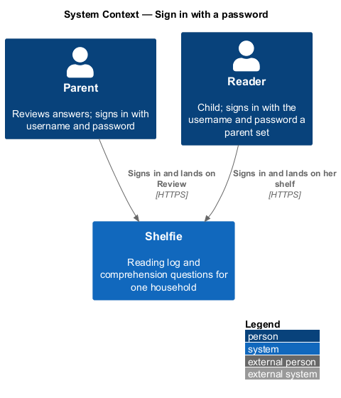
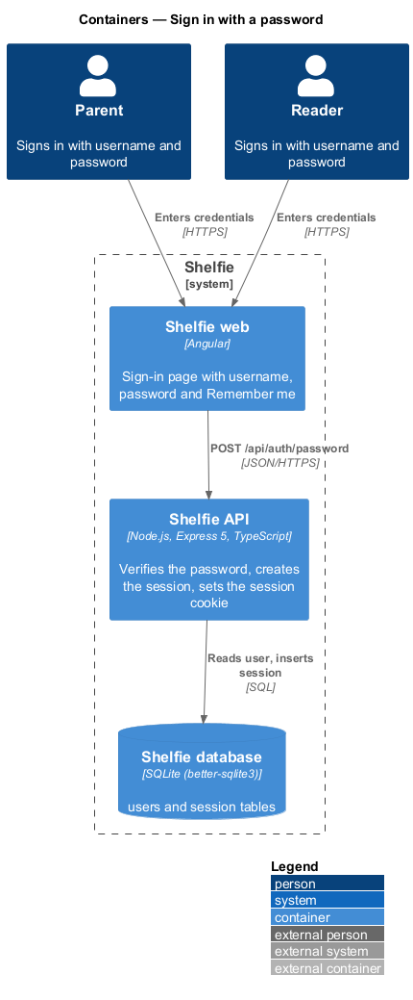
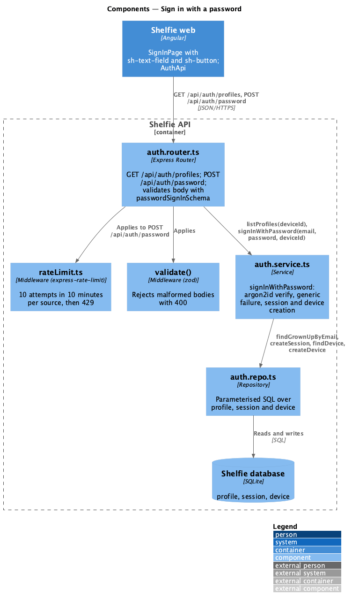
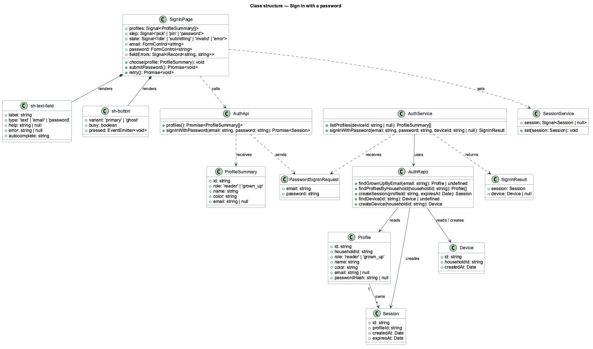
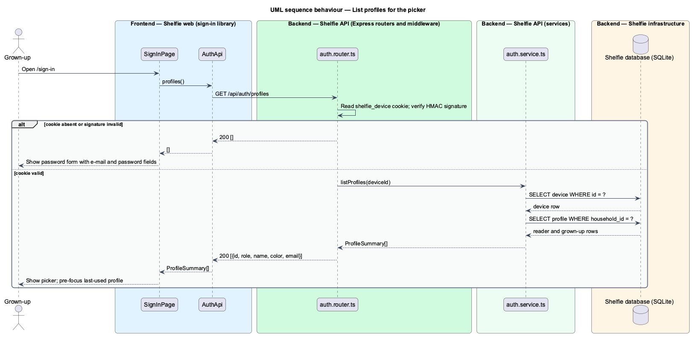
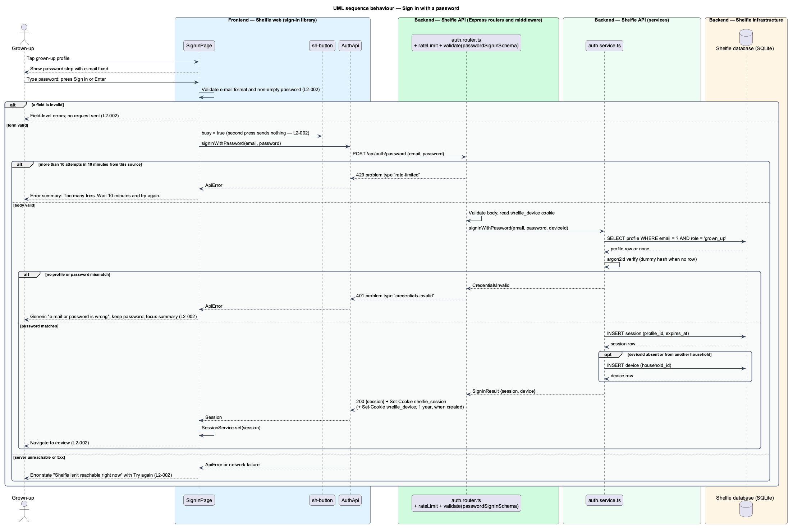

# Sign in with a password

## Overview

Shelfie is a web application that helps one child read books by logging each chapter she reads and answering short questions about it, while a grown-up in the same household reviews her answers and gives rewards. A **household** is the unit of tenancy: exactly one reader profile and one grown-up profile, sharing one bookshelf.

This feature is the grown-up's way into the application. A **profile** is one person in the household, with a role of `reader` or `grown_up`, a display name and an avatar colour; the grown-up profile also carries an e-mail address and a password hash. The grown-up signs in with that e-mail and a **password**, a secret of his own choosing that he can change in Settings or reset by e-mail. A successful sign-in creates a **session** (a server-side row referenced by an HttpOnly cookie) and lands him on Review, where the reader's answers wait for him.

Password sign-in also introduces the **device cookie**: a long-lived, signed cookie named `shelfie_device` that the API sets on a browser the first time the grown-up signs in there with a password. The cookie names the household, so from then on the sign-in page can list the household's two profiles as a **profile picker** without anyone being signed in. Tapping the reader's card leads to the PIN step (sign-in-with-pin); tapping the grown-up's card leads to the password step with his e-mail already filled in. A browser without the cookie has no picker and shows only the password form, with an e-mail field and a password field.

Wrong credentials produce one generic failure that does not say whether the e-mail or the password was wrong. Repeated failures from one source are rate limited by the API (10 attempts in 10 minutes, then `429`), a control the platform subsystem's harden-api design owns and this feature applies to its endpoint.

The feature sits in the `sign-in` subsystem beside PIN sign-in, session management, password reset and route authorisation. It is the grown-up's only entry point other than a completed password reset.

## Description

The slice runs from the sign-in page to the `profile`, `session` and `device` tables.

- **`SignInPage`** — page component in the `sign-in` library. On load it calls `GET /api/auth/profiles`; when profiles come back it renders the picker (`default` state, one `sh-profile-card` per profile, the last-used profile pre-focused from `localStorage`); when none come back it renders the password form with an e-mail field. Choosing the grown-up shows the `password` step: avatar, "Hi Dad!", "Signing in as marcus@example.com", a "Not Dad?" link back to the picker, a password field, a Sign in button and a "Forgot your password?" link to `/forgot-password`. It owns the `password`, `invalid`, `submitting` and `error` states shown in `docs/mocks/pages/sign-in/`. Before sending, it validates the form: an empty or malformed e-mail and an empty password produce field-level errors and no request (`L2-002`). On submit the button enters its busy state and further presses send nothing. Enter submits.
- **`sh-text-field`** — component in the `components` library: label, optional help text, error slot linked through `aria-describedby`, `type` of `text`, `email` or `password`, `autocomplete` pass-through.
- **`sh-button`** — component in the `components` library: primary and ghost variants, block and large sizes, and a `busy` input that disables the button, sets `aria-busy` and shows a spinner.
- **`sh-profile-card`** — reused from sign-in-with-pin.
- **`AuthApi`** — service in the `sign-in` library built on `ApiClient`. `profiles()` gets `/api/auth/profiles` and returns `ProfileSummary[]` (empty without a device cookie). `signInWithPassword(email, password)` posts to `/api/auth/password` and returns a typed `Session` or throws `ApiError`.
- **`SessionService`** — service in the `core` library; set from the response, then the page navigates to `/review`.
- **`auth.router.ts`** — Express router. `GET /api/auth/profiles` reads the `shelfie_device` cookie, verifies its HMAC signature, and returns the household's profiles (`id`, `role`, `name`, `color`, and `email` for the grown-up); an absent or invalid cookie yields an empty list. `POST /api/auth/password` applies the login rate limiter from `platform/rateLimit.ts`, validates the body with `passwordSignInSchema` (`email: string, e-mail format`, `password: string, at least 1 character`) through `validate()`, then calls the service.
- **`auth.service.ts`** — `signInWithPassword(email, password, deviceId)`: loads the grown-up profile by e-mail, verifies `password` against `password_hash` with argon2id, and answers unknown e-mail and wrong password with the same `credentials-invalid` failure, verifying against a fixed dummy hash when the e-mail is unknown so both paths take the same time. On success it creates a session and, when `deviceId` is absent or belongs to another household, inserts a `device` row for the profile's household and returns its signed id so the router can set `shelfie_device`.
- **`auth.repo.ts`** — parameterised SQL over `profile`, `session` and `device`: `findGrownUpByEmail`, `createSession`, `findDevice`, `createDevice`.
- **`profile`** table columns used: `id`, `household_id`, `role`, `name`, `color`, `email`, `password_hash`.
- **`session`** table: `id`, `profile_id`, `created_at`, `expires_at`. The response sets cookie `shelfie_session` (HttpOnly, Secure, SameSite=Strict); a new session id is issued on every sign-in.
- **`device`** table: `id`, `household_id`, `created_at`. Cookie `shelfie_device` carries the id and an HMAC-SHA256 signature over it (HttpOnly, Secure, SameSite=Strict, 1 year); the signing key comes from the `SHELFIE_DEVICE_KEY` environment variable.

The error body for wrong credentials is a problem document with `type: "credentials-invalid"` and status `401`; the page shows the `invalid` state, moves focus to the error summary and keeps the typed password so a typo can be fixed. A `429` from the rate limiter is shown in the same summary slot with the copy "Too many tries. Wait 10 minutes and try again.", as no mock state exists for it. A network failure or a `5xx` shows the `error` state ("Shelfie isn't reachable right now") with a Try again action that resubmits.

The mock's `invalid` copy reads "That password didn't match" because the e-mail is fixed by the chosen profile; in the form without a device cookie, where the e-mail is typed, the same failure reads "e-mail or password is wrong" so that neither field is singled out (`L2-002`).

## Requirements

The feature realizes the following level-2 (L2) requirements. Each refines a level-1 (L1) requirement, cited by identifier.

| L2 ID | Refines (L1) | Requirement |
|-------|--------------|-------------|
| `L2-002` | `L1-001` | The grown-up signs in with e-mail and password. Given valid credentials he lands on Review; an empty or malformed e-mail or an empty password shows field-level errors and sends no request; wrong credentials show one generic "e-mail or password is wrong" error that does not reveal which was wrong; while a submission is in flight a second press sends nothing and the button shows a busy state; an unreachable server shows an error state with a retry action. |

## Diagrams

### System context

The grown-up signs in to Shelfie with his e-mail and password; the reader benefits indirectly, because the device cookie his sign-in leaves behind lets the picker show her profile.

### Containers

The sign-in page in the Angular application lists profiles and posts credentials to the Express API, which verifies the password against the SQLite database and sets the session and device cookies.

### Components

Inside the API, the auth router applies the rate limiter and body validation, then delegates to `auth.service.ts`, which reads the profile, inserts a session and, when needed, a device row through `auth.repo.ts`.

### Class structure

`SignInPage` composes `sh-text-field` and `sh-button` and calls `AuthApi`; the service verifies against `Profile` and creates a `Session` and a `Device`.

### Behaviour — list profiles for the picker

On load the page asks for the household's profiles; the device cookie decides whether the picker or the bare password form is shown.

### Behaviour — sign in with a password

The happy path creates a session, sets the device cookie when it is missing and navigates to Review; the alternate paths show client-side validation, wrong credentials, the rate limit and an unreachable server (`L2-002`).

