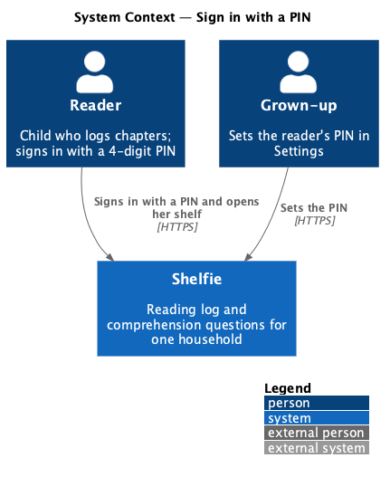
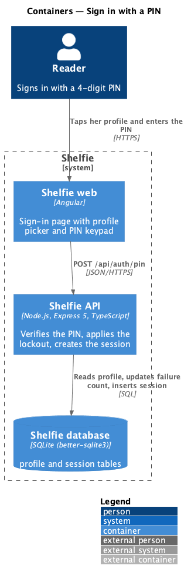
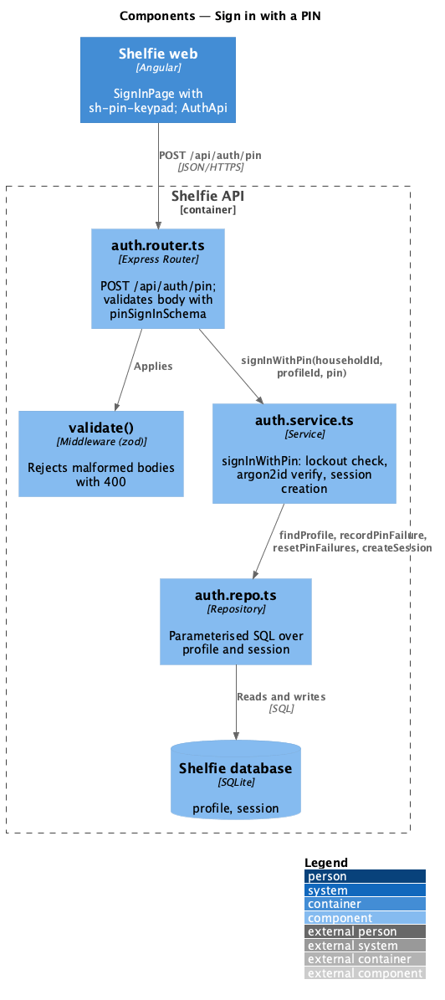
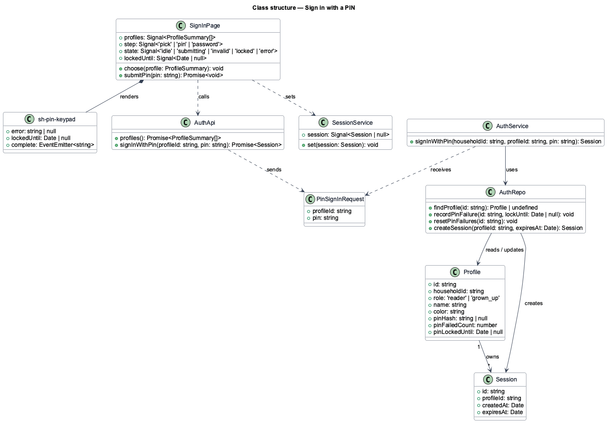
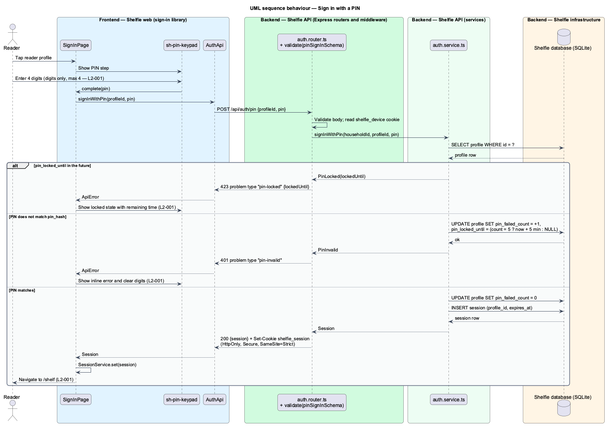

# Sign in with a PIN

## Overview

Shelfie is a web application that helps one child read books by logging each chapter she reads and answering short questions about it, while a grown-up in the same household reviews her answers and gives rewards. A **household** is the unit of tenancy: exactly one reader profile and one grown-up profile, sharing one bookshelf.

This feature is the reader's way into the application. A **profile** is one person in the household, with a role of `reader` or `grown_up`, a display name and an avatar colour. The reader signs in by tapping her profile on the sign-in page and entering a **PIN**, a 4-digit code that the grown-up sets in Settings. The PIN keeps the shelf hers without asking a 9-year-old for a password.

The sign-in page knows which household's profiles to show through a **device cookie**: a long-lived, signed cookie that the API sets on a device the first time the grown-up signs in with a password there. Without it the page offers only the password form, and the PIN route does not apply.

Wrong PINs are counted. After five consecutive failures the keypad locks for five minutes, and a correct PIN is refused until the lock lifts. A successful sign-in resets the count, creates a **session** (a server-side row referenced by an HttpOnly cookie) and sends the reader to her shelf.

The feature sits in the `sign-in` subsystem beside password sign-in, session management, password reset and route authorisation. It is the reader's only entry point.

## Description

The slice runs from the sign-in page to the `profile` and `session` tables.

- **`SignInPage`** — page component in the `sign-in` library. It renders `sh-profile-card` for each profile from `GET /api/auth/profiles`, and on choosing the reader shows the PIN step. It owns the `pin`, `pin-invalid`, `locked`, `submitting` and `error` states shown in `docs/mocks/pages/sign-in/`.
- **`sh-profile-card`** — component in the `components` library: avatar initial, name, role label; a button.
- **`sh-pin-keypad`** — component in the `components` library: four masked digit slots, a 0–9 keypad, backspace, an inline error slot and a `locked` input that shows the remaining lock time. It emits `complete(pin: string)` when the fourth digit is entered. It accepts digits only.
- **`AuthApi`** — service in the `sign-in` library built on `ApiClient`. `signInWithPin(profileId, pin)` posts to `/api/auth/pin` and returns a typed `Session` or throws `ApiError`.
- **`SessionService`** — service in the `core` library; holds the current session as a signal and is set from the response.
- **`auth.router.ts`** — Express router. `POST /api/auth/pin` validates the body with `pinSignInSchema` (`profileId: string`, `pin: /^[0-9]{4}$/`) through `validate()`, then calls the service.
- **`auth.service.ts`** — `signInWithPin(deviceHouseholdId, profileId, pin)`: loads the profile, refuses when the profile is not in the device's household or not a reader, refuses while `pin_locked_until` is in the future, verifies `pin` against `pin_hash` with argon2id, increments `pin_failed_count` on failure and sets `pin_locked_until` to now + 5 minutes on the fifth, resets the count and creates a session on success.
- **`auth.repo.ts`** — parameterised SQL over `profile` and `session`.
- **`profile`** table columns used: `id`, `household_id`, `role`, `name`, `color`, `pin_hash`, `pin_failed_count`, `pin_locked_until`.
- **`session`** table: `id`, `profile_id`, `created_at`, `expires_at`. The response sets cookie `shelfie_session` (HttpOnly, Secure, SameSite=Strict).

The error body for a wrong PIN is a problem document with `type: "pin-invalid"`; for a lock it is `type: "pin-locked"` and carries `lockedUntil`. The page maps these to the `pin-invalid` and `locked` states. Rate limiting of the endpoint beyond the per-profile lock is `<TO SUPPLY>`.

## Requirements

The feature realizes the following level-2 (L2) requirements. Each refines a level-1 (L1) requirement, cited by identifier.

| L2 ID | Refines (L1) | Requirement |
|-------|--------------|-------------|
| `L2-001` | `L1-001` | The reader signs in by choosing her profile and entering a 4-digit PIN. Given the correct PIN she is taken to her shelf; a wrong PIN shows an inline error and clears the keypad; five consecutive wrong PINs lock the keypad for 5 minutes showing the remaining time; a correct PIN is refused while locked; non-digits are rejected and at most 4 digits are accepted. |

## Diagrams

### System context

The reader and the grown-up both use Shelfie; this slice concerns the reader's entry.

### Containers

The sign-in page in the Angular application calls the Express API, which verifies the PIN against the SQLite database and sets the session cookie.

### Components

Inside the API, the auth router validates the body and delegates to `auth.service.ts`, which reads and updates the profile row and inserts a session through `auth.repo.ts`.

### Class structure

`SignInPage` composes `sh-pin-keypad` and calls `AuthApi`; the service verifies against `Profile` and creates a `Session`.

### Behaviour — sign in with a PIN

The happy path creates a session; the alternate paths show a wrong PIN and the fifth failure that locks the profile (`L2-001`).

