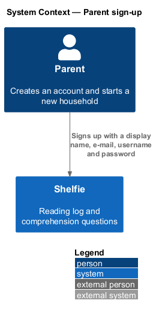
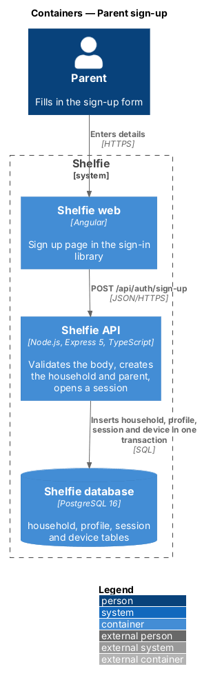
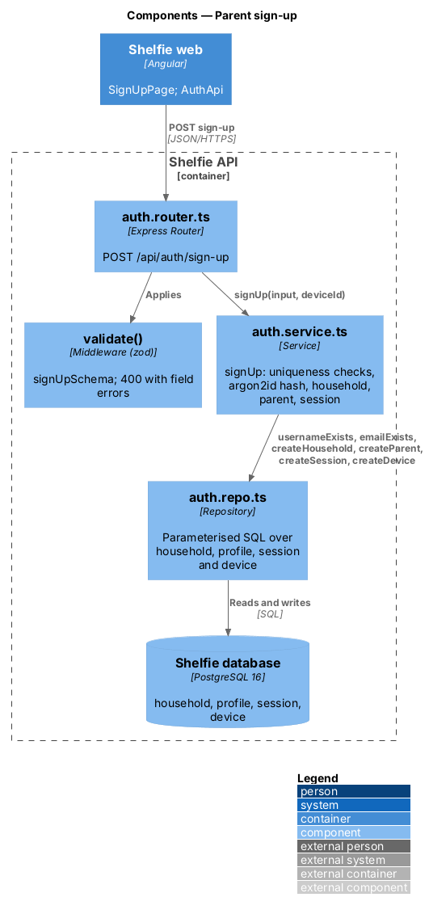
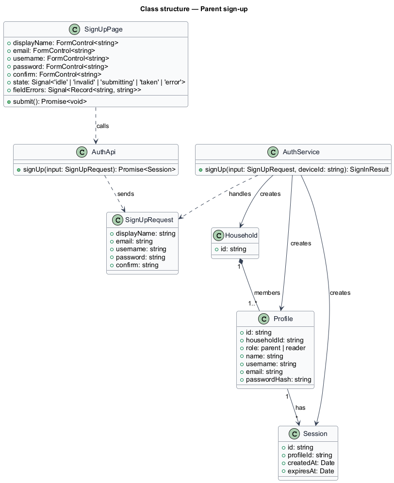
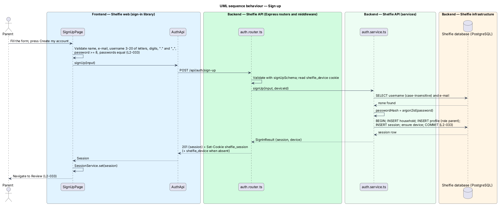
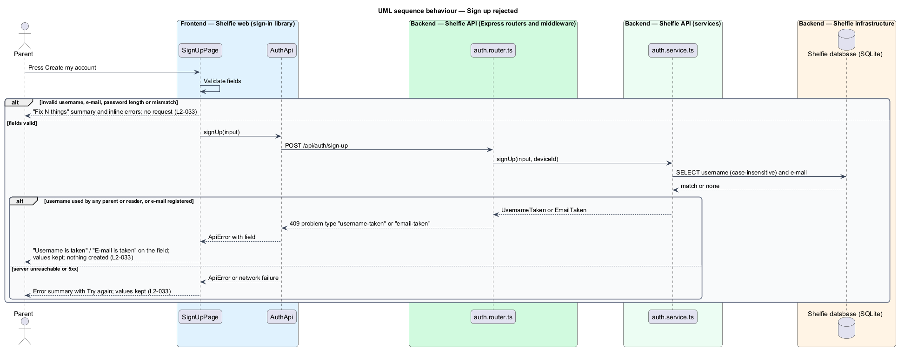

# Parent sign-up

## Overview

Shelfie is a web application that helps children read books by logging each chapter they read and answering short questions about it, while a parent reviews the answers and gives rewards. A **household** is the unit of tenancy: a group of parents and readers sharing one bookshelf. A **parent** is a person who holds an account and reviews reading. A **reader** is a child profile that a parent creates; a reader never signs up.

Only parents hold accounts. A person who has no account and no invite creates one on the **Create a parent account** page, reached from the Sign in page. Signing up starts a new household with that parent as its only member. The parent enters a display name, an e-mail address, a **username** and a password typed twice. The username is the name used at every sign-in; it is unique across all parents and readers, ignoring case. The e-mail address is used for password recovery and for invites.

On success the household and parent are created, the parent is signed in on this device and Review opens. A username or e-mail that is already in use is reported inline on its field, and the values entered stay in the form.

The feature sits in the `sign-in` subsystem beside password sign-in, accept-invite, session management and password reset. A person who instead holds an invite link joins an existing household through accept-invite.

## Description

The slice runs from one page in the sign-in library to the `household`, `profile`, `session` and `device` tables.

- **`SignUpPage`** — page component in the `sign-in` library at `/sign-up`. Fields: Your name, E-mail address, Username (help text "3–20 letters, numbers, . or _"), Password (help text "At least 8 characters") and Type it again, plus a Create my account button and an "Already have an account? Sign in" link. It owns the states in `docs/mocks/pages/sign-up/`: `default`, `invalid`, `submitting`, `taken` and `error`. Client-side validation enforces the username length and character set, a well-formed e-mail, the 8-character minimum and equality of the two password boxes; failures show the "Fix N things" summary and field errors, and no request is sent. A server answer of `taken` names each field in `fields` (`username`, `email`); the page shows "Username is taken" or "E-mail is taken" in the summary and "That username is taken." or "That e-mail already has an account." on the field, both at once when both are taken. Any other failure shows the `error` state with the entered values kept.
- **`AuthApi`** — `signUp(input)` posts to `/api/auth/sign-up` and returns a `Session`.
- **`auth.router.ts`** — `POST /api/auth/sign-up` validates with `signUpSchema` (`displayName`, `email`, `username` matching `^[A-Za-z0-9._]{3,20}$`, `password` of at least 8 characters, `confirm` equal to `password`) and answers `201 {session}` with `Set-Cookie shelfie_session` and, when the device cookie is absent, `Set-Cookie shelfie_device`. It requires no session.
- **`auth.service.ts`** — `signUp(input, deviceId)`: checks that the lower-cased username is unused by any parent or reader and that the e-mail is unregistered, failing with one `taken` problem (HTTP `409`) whose `fields` lists `username`, `email` or both; hashes the password with argon2id (`L2-027`); then, in one transaction, inserts the `household`, inserts the `profile` with role `parent`, inserts the session and ensures the device row.
- **`auth.repo.ts`** — `usernameExists`, `emailExists`, `createHousehold`, `createParent`, `createSession`, `createDevice`. All SQL is parameterised.
- **Remember me** — the sign-up page offers no "Remember me" control in the mock; the session created here is remembered (30-day idle timeout), as the sign-in page's switch defaults to on.

Data changes this feature relies on, shared with accept-invite and password sign-in:

- **`profile.username`** — new `TEXT NOT NULL` column, with a unique index on `lower(username)` so that uniqueness ignores case across both roles. The stored value keeps the case the person typed; sign-in matches case-insensitively.
- **`profile.role`** — values `parent` and `reader`, replacing the earlier `grown_up` value; migration `012-directory.sql` adds `author` and `volunteer`, which have no household (ADR-0019).
- **`profile.household_id`** — unchanged; a household now has one or more parents and any number of readers.
- **`profile.email`** — required and unique, case-insensitively, for a parent; null for a reader.
- **PIN columns** — `pin_hash`, `pin_failed_count` and `pin_locked_until` are removed.
- **Existing table name** — the codebase names the table `profile`; the requirement text and the migration plan call the same entity `users`. The name used in code is kept: the table stays `profile`, and `session.profile_id` keeps its name; the migration in `db.ts` rebuilds the table in place.
- **Household display name** — the accept-invite mock shows "Join the Bells"; no household name is stored and sign-up does not ask for one; the Join page names the inviting parent instead ("Join Dad’s household").

**Authors and volunteers** do not use this page; it stays the parent's sign-up. They join on their own page, `/join` (`JoinPage` in the `sign-in` library, `POST /api/auth/join`), linked from Sign in under the parent's link. It creates a profile with role `author` or `volunteer` and no household, which this feature's `takenFields()` check also covers, because usernames and e-mails stay unique across every role. See `directory/author-profile` and `directory/volunteer-profile` (`L2-144`, ADR-0019).

## Requirements

The feature realizes the following level-2 (L2) requirements. Each refines a level-1 (L1) requirement, cited by identifier.

| L2 ID | Refines (L1) | Requirement |
|-------|--------------|-------------|
| `L2-033` | `L1-001` | A person creates a parent account by signing up, which starts a new household. Given the sign-up page, when a parent submits a display name, e-mail, username, and a password of at least 8 characters typed twice identically, then a new household is created with that parent as its only member, the parent is signed in on this device and lands on Review. Given a username outside 3-20 characters or containing characters other than letters, digits, "." and "_", when submitted, then a field-level error is shown and no request is sent. Given a malformed e-mail, a password under 8 characters or two password boxes that differ, when submitted, then field-level errors are shown and no request is sent. Given a username already taken by any parent or reader, ignoring case, or an e-mail already registered, when submitted, then an inline error names the field and nothing is created. Given a failure, when submitted, then an error is shown and the entered values are kept. |

## Diagrams

### System context

A parent signs up with Shelfie directly; no external system takes part.

### Containers

The Sign up page in the Angular application posts to the Express API, which creates the household, parent and session in the PostgreSQL database in one transaction.

### Components

Inside the API, the auth router validates the body and delegates to `auth.service.ts`, which uses `auth.repo.ts` for uniqueness checks and inserts.

### Class structure

`SignUpPage` calls `AuthApi`; `AuthService` creates a `Household`, a parent `Profile` and a `Session`.

### Behaviour — sign up

The page validates the form, the API checks uniqueness, creates the household and parent in one transaction and signs the parent in, and Review opens (`L2-033`).

### Behaviour — sign-up rejected

Client-side validation failures send nothing; a taken username or e-mail returns `409` and an inline error; any other failure shows an error; in every case the entered values stay and nothing is created (`L2-033`).

