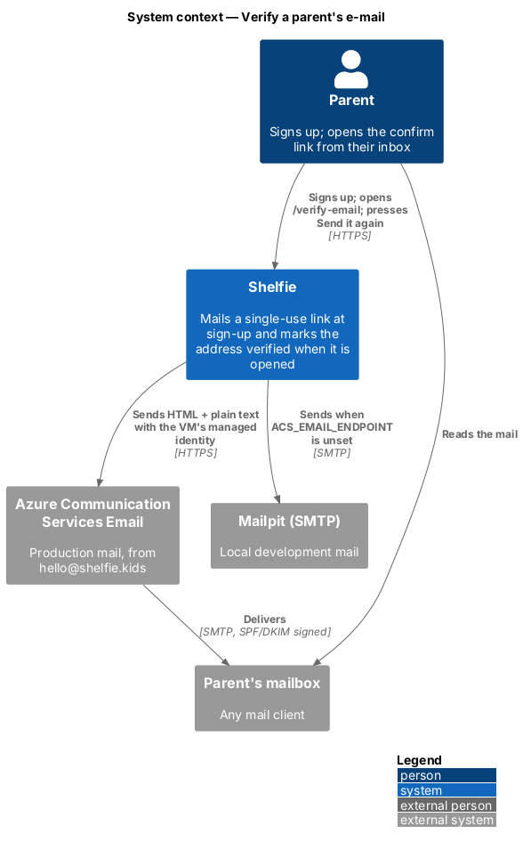
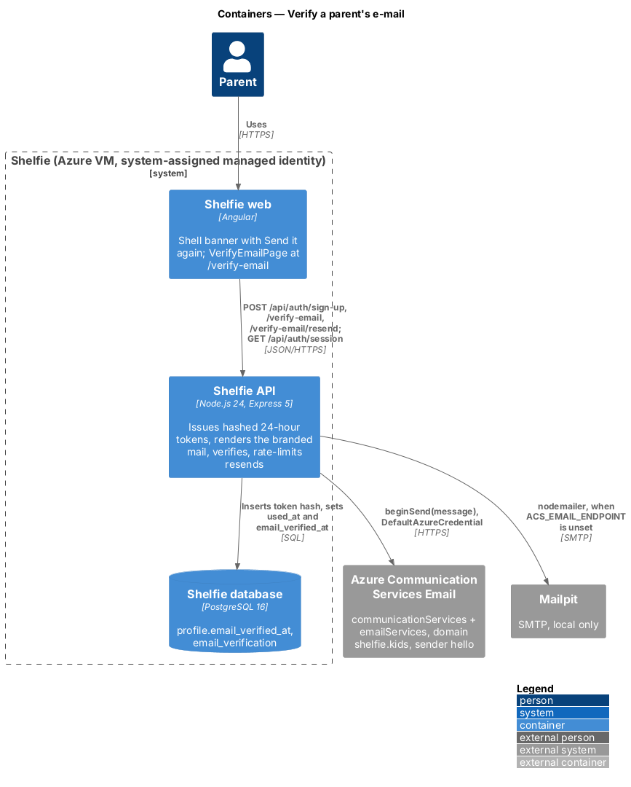
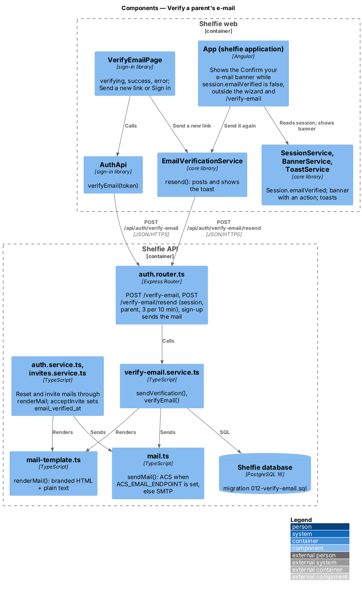
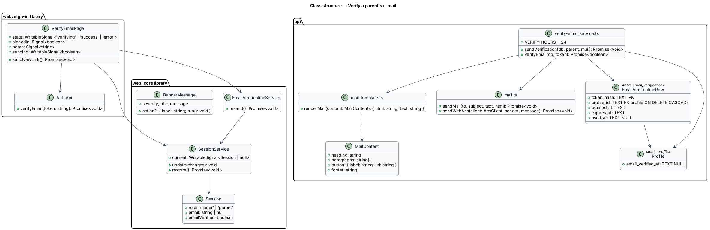
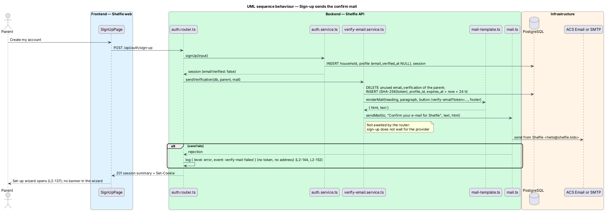
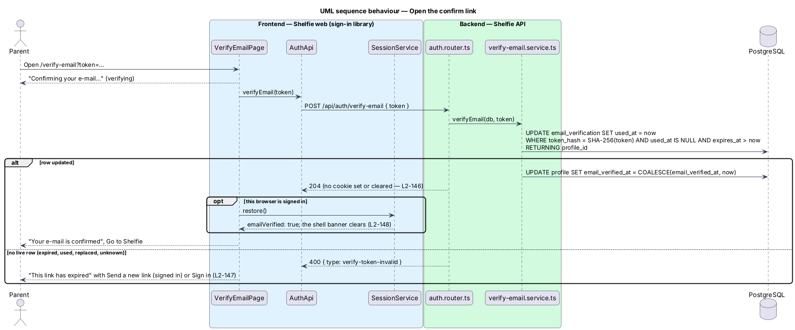
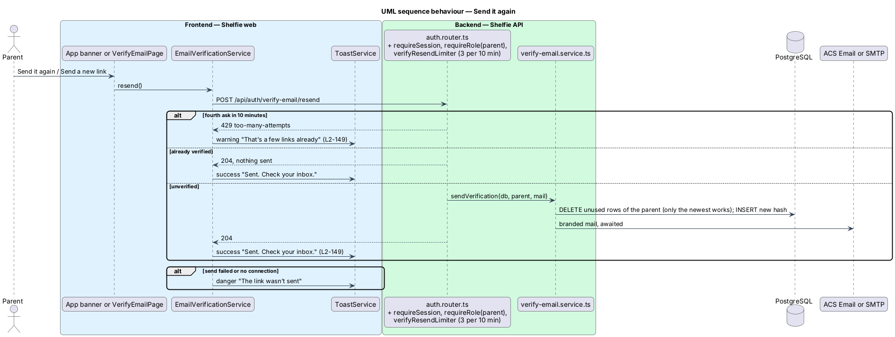

# Verify a parent's e-mail

## Overview

Shelfie is a web application that helps children read books by logging each chapter they read and answering short questions about it, while a parent in the same household reviews the answers and gives rewards. A **household** is the unit of tenancy. Only parents hold accounts and only parents have an e-mail address; readers have none.

A parent who signs up types an e-mail address that nothing checks today. Password reset (`reset-password`) mails a link to that address, so a typo silently strands the account. This feature confirms the address once, at sign-up, without slowing sign-up down: Shelfie mails a **confirm link** from `Shelfie <hello@shelfie.kids>`, and the parent opens it whenever they like. Sign-up behaves as before: the parent is signed in and the set-up wizard opens (`L2-033`, `L2-137`). Until the link is opened, a persistent **Confirm your e-mail** banner with **Send it again** shows in the parent shell. Nothing is blocked while the address is unconfirmed.

The feature also gives Shelfie its production mail provider. Every mail Shelfie sends (the confirm link, the password-reset link and the parent invite) moves to one branded HTML template with a plain-text part, and goes through **Azure Communication Services (ACS) Email** when `ACS_EMAIL_ENDPOINT` is set, and over SMTP to Mailpit otherwise (ADR-0019).

Terms used below:

- **confirm link** — `{APP_URL}/verify-email?token=<token>`, where the token is 32 random bytes in base64url. Valid for 24 hours, usable once; only the newest one of a parent works.
- **verified** — `profile.email_verified_at` is set. The session summary carries it as `emailVerified`.
- **branded mail** — the HTML part rendered by `renderMail` (`docs/design-system/foundations/email.html`, mocks in `docs/mocks/notifications/email/`), sent with a plain-text part of the same words.

## Description

The slice runs from the shell banner and one new page in the `sign-in` library to a new table and column, with one call out to the mail provider. Mocks: `docs/mocks/pages/verify-email/`, `docs/mocks/notifications/banner/verify-email*.html` and `docs/mocks/notifications/email/`. Screen composition: `docs/screen-composition.md` (Confirm your e-mail, the shell banner slot, E-mail).

### Data

- **Migration `apps/api/migrations/012-verify-email.sql`** (migrations are files applied in name order by `migrate()` in `apps/api/src/db.ts`):
  - `ALTER TABLE profile ADD COLUMN email_verified_at TEXT` (ISO-8601, as every timestamp in the schema), then `UPDATE profile SET email_verified_at = <now> WHERE role = 'parent' AND email IS NOT NULL`. Every parent who exists when the release ships counts as verified (`L2-150`).
  - `CREATE TABLE email_verification (token_hash TEXT PRIMARY KEY, profile_id TEXT NOT NULL REFERENCES profile(id) ON DELETE CASCADE, created_at TEXT NOT NULL, expires_at TEXT NOT NULL, used_at TEXT)` with an index on `profile_id`. Only the SHA-256 hash of the token is stored (`L2-145`); erasing a household erases its rows through the cascade (`L2-041`).
- **Seed and import.** `seed.ts` inserts the seeded parent as verified, as an existing parent. `import-sqlite.ts` copies an old installation into an empty database that is already migrated, after the back-fill has run, so it sets `email_verified_at` on the parents it imports: they existed before this release.

### API

- **`verify-email.service.ts`** (new):
  - `sendVerification(db, parent, mail)` deletes the parent's unused `email_verification` rows, so only the newest link works (`L2-149`), inserts the hash of a fresh token with `expires_at` = now + 24 hours, renders the mail with `renderMail` and sends it with the injected `Mail`. Subject "Confirm your e-mail for Shelfie"; heading "Confirm your e-mail"; text "Hi {name}, welcome to Shelfie! Tap the button to confirm this address is yours. The link works once, for 24 hours."; button "Confirm my e-mail".
  - `verifyEmail(db, token)` marks the live row used with one `UPDATE … WHERE token_hash = $1 AND used_at IS NULL AND expires_at > $2 RETURNING profile_id`, so two clicks cannot both succeed, then sets `profile.email_verified_at` when it is still null. Returns whether a row was spent.
- **`auth.router.ts`**:
  - `POST /api/auth/sign-up` calls `sendVerification` after the account exists and does **not** await the provider: the response is `201` with the session whatever the mail does. A rejected send is logged through `res.locals.log` as `{ level: 'error', event: 'verify-mail-failed' }` with the request id only, never the token, link or address (`L2-144`, `L2-152`).
  - `POST /api/auth/verify-email` `{ token }` (no session, CSRF header as every `/api` write) answers `204` on success and `400 { type: 'verify-token-invalid' }` otherwise. It neither reads nor sets the session cookie (`L2-146`).
  - `POST /api/auth/verify-email/resend` runs `requireSession`, `requireRole('parent')` and `verifyResendLimiter` (the existing `rateLimiter`, 3 per parent in 10 minutes, `429 too-many-attempts`), then answers `204`: after `sendVerification` (awaited, so a failed send is a `500` problem) when unverified, or at once when already verified (`L2-149`).
  - `GET /api/auth/session` and every session summary gain `emailVerified` (`createSession` and `requireSession` read `email_verified_at IS NOT NULL`).
- **`invites.service.ts`** — `acceptInvite` inserts the new parent with `email_verified_at` = now: the invite link reached that address (`L2-150`). No confirm mail is sent.

### Mail

- **`mail-template.ts`** (new) — `renderMail({ heading, paragraphs, button: { label, url }, footer })` returns `{ html, text }`. The HTML is the table layout and inline styles of `docs/design-system/foundations/email.html`: a 560px fluid column on the `#f6f7f9` canvas, the logo from `{APP_URL}/logo.png`, a white card with the heading, the paragraphs, the bulletproof button, the link repeated as text, then the footer. Every interpolated string is HTML-escaped (`L2-151`). The text part is the heading, paragraphs, bare link, footer and `Shelfie · https://www.shelfie.kids`, separated by blank lines.
- **Reset and invite** — `requestPasswordReset` and `createInvite` keep their subjects, wording, tokens and lifetimes and send `renderMail` output: reset heading "Choose a new password", button "Choose a new password"; invite heading "Join {name} on Shelfie", button "Create my account".
- **`mail.ts`** — `sendMail(to, subject, text, html)`; the `Mail` type is still `typeof sendMail`, injected through `createApp({ mail })`, so API and Playwright tests pass a fake that keeps the message.
  - With `ACS_EMAIL_ENDPOINT` set it sends through `@azure/communication-email`'s `EmailClient`, created once with `DefaultAzureCredential` (on the VM, its system-assigned managed identity), from `ACS_EMAIL_SENDER` (default `hello@shelfie.kids`; the display name "Shelfie" comes from the ACS sender username). `sendWithAcs(client, sender, message)` holds that logic with the client passed in, so a test gives it a fake: it calls `beginSend` with both parts and `pollUntilDone`, and throws unless the status is `Succeeded` (`L2-153`).
  - Otherwise with `SMTP_URL` set it sends with nodemailer from `MAIL_FROM`, default `Shelfie <hello@shelfie.kids>`.
  - With neither, it logs a warning without the address and sends nothing.

### Web

- **`Session`** (`core`) gains `emailVerified: boolean`.
- **`BannerService`** messages gain an optional `action: { label, run }`. The shell renders it as a `button.btn.btn--sm` projected into `sh-banner`'s `.alert__actions`.
- **`EmailVerificationService`** (`core`, new) — `resend()` posts `/auth/verify-email/resend` and shows the toast: `success` "Sent. Check your inbox." with "Only the newest link works.", `warning` "That’s a few links already" on `429`, `danger` "The link wasn’t sent" otherwise.
- **`App`** (`apps/web/projects/shelfie/src/app/app.ts`) — an effect shows the banner `info` "Confirm your e-mail", "We sent a link to {email}. Open it to confirm the address is yours.", action "Send it again" → `resend()`, while the session is a parent's with `emailVerified` false and the URL is neither the wizard nor `/verify-email`; it clears the banner otherwise (`L2-148`).
- **`VerifyEmailPage`** (`sign-in` library, `/verify-email`, no guard) — reads `token` from the query, shows `verifying` while `AuthApi.verifyEmail(token)` runs, then `success` or `error`. On success, if this browser is signed in, it re-reads the session so the banner clears without a reload. Success's "Go to Shelfie" goes to the person's home (`homeOf`) or `/sign-in`. Error offers "Send a new link" (`resend()`) when signed in and "Sign in" otherwise (`L2-146`, `L2-147`).

### Infrastructure

`infra/main.bicep` adds the ACS resources (communication service, e-mail service, the customer-managed `shelfie.kids` domain, the `hello` sender username with display name "Shelfie"), the `linkEmailDomain` parameter (false until Azure reports the domain verified), the role assignment that lets the VM's identity send, and the endpoint and sender as outputs. `infra/bootstrap.sh` writes `ACS_EMAIL_ENDPOINT` and `ACS_EMAIL_SENDER` into `/etc/shelfie/env`. `docs/runbook.md` lists the Namecheap DNS records and the link-after-verified steps (ADR-0019, `platform/operate-service`).

## Requirements

| L2 ID | Refines (L1) | Requirement |
|-------|--------------|-------------|
| `L2-144` | `L1-001` | Sign-up mails a confirm link from `Shelfie <hello@shelfie.kids>`; sign-up answers `201` even when the mail fails, and the session says `emailVerified: false`. |
| `L2-145` | `L1-001`, `L1-012` | The link is 32 random bytes, works once for 24 hours; only its SHA-256 hash is stored; a newer link replaces older ones. |
| `L2-146` | `L1-001` | Opening a live link marks the e-mail verified and shows "Your e-mail is confirmed"; no session is created, changed or ended. |
| `L2-147` | `L1-001` | An expired, used, replaced or unknown link shows "This link has expired" with Send a new link (signed in) or Sign in. |
| `L2-148` | `L1-001`, `L1-010` | The "Confirm your e-mail" banner shows on every shell page of an unverified parent, not in the wizard or on the confirm page; nothing is blocked. |
| `L2-149` | `L1-001`, `L1-012` | Send it again mails a fresh link, only the newest works, and a fourth ask in 10 minutes answers `429` and sends nothing. |
| `L2-150` | `L1-001` | Parents who accept an invite, and parents from before the release, are verified. |
| `L2-151` | `L1-001`, `L1-011` | The confirm, reset and invite mails are branded HTML with a plain-text part; reset and invite wording is unchanged. |
| `L2-152` | `L1-012`, `L1-013` | Tokens, links and addresses never appear in logs. |
| `L2-153` | `L1-001`, `L1-013` | ACS when `ACS_EMAIL_ENDPOINT` is set, SMTP otherwise, nothing (with a warning) when neither is. |

## Decisions

- **The mail is sent after sign-up, unawaited.** ACS's send is a long-running operation polled to completion and can take seconds; sign-up should not wait for it or fail because of it. The token row is written before the response, so a resend always has a row to replace.
- **One table, rows deleted on resend.** Deleting a parent's unused rows when a new link is issued makes "only the newest works" a property of the data, with no generation counter.
- **The resend limit reuses `sign_in_attempt`** through the existing `rateLimiter`, keyed `verify:<profileId>`. No new table.
- **No change to the reset and invite tokens.** They keep their tables and lifetimes; only the mail body changes.
- **A danger toast for a failed resend.** The banner stays, so the parent can try again; the mock `notifications/banner/verify-email-failed.html` shows it.

## Diagrams

### System context

The parent signs up and later opens the link from their mailbox; Shelfie sends through ACS in production and Mailpit locally.

### Containers

The Angular app posts to the API on the VM, which keeps the token hash and the verified time in PostgreSQL and sends through ACS with the VM's managed identity.

### Components

The shell banner and `VerifyEmailPage` share `EmailVerificationService` for Send it again; the router delegates to `verify-email.service.ts`, which renders with `mail-template.ts` and sends with `mail.ts`, as the reset and invite mails now do.

### Class structure

### Behaviour — sign-up sends the confirm mail

The account and session are created as before; the confirm row is written and the mail handed to the provider without holding up the `201` (`L2-144`).

### Behaviour — open the confirm link

One conditional update spends the token; success marks the profile verified and, when this browser is signed in, refreshes the session so the banner clears (`L2-146`, `L2-147`).

### Behaviour — Send it again

Session, parent role and the 3-in-10-minutes limit guard the resend; a fresh link replaces older ones (`L2-149`).

## Open questions

- **Changing the e-mail in Settings (deferred).** `settings/edit-household-settings` lets a parent change their e-mail, and that change does not clear `email_verified_at` or send a confirm link in this feature. The changed address is therefore trusted without proof. Re-verifying a changed e-mail is deferred (AGENTS.md, Deferred work).
- **Blocking unverified parents (deferred).** Nothing is gated on `emailVerified`; password reset still mails an unconfirmed address.
- **Dark-mode mail, bounces and complaints (deferred).** The mail is light only. ACS bounce and complaint events, unsubscribe headers and any marketing mail are not handled.
- **Link lifetime (resolved).** 24 hours: long enough to find the mail the next morning, and Send it again covers the rest.
