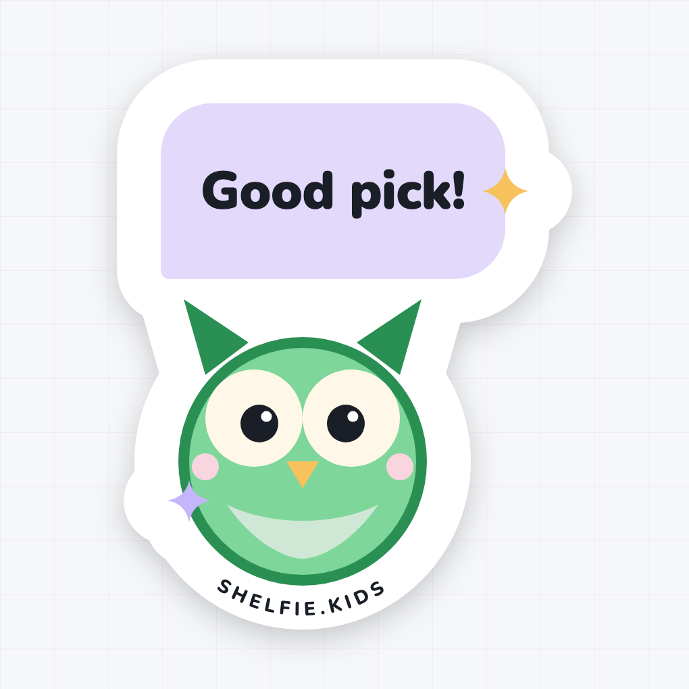

# Shelfie promotional stickers

Four die-cut vinyl stickers to give away for laptop lids, water bottles and
book bags. They are promotional artwork, not an app feature: the in-app
stickers (`sh-sticker-picker`) are separate and unchanged. Every shape, colour
and typeface comes from Shelfie's own assets rather than being redrawn by eye,
so a sticker on a laptop and the app on a phone read as the same product.

Refreshed on 2026-10-19 after the [Beanstack review](../competitive-review/beanstack.md)
and the design-system changes it drove (see the changelog in
[docs/design-system/README.md](../design-system/README.md)). What carried over:

- **Pastel-first** (R1): a sticker's surface is a cover pastel or a chat
  bubble; saturated violet appears only on the app icon, the wordmark, the
  badge ring and the chip. Every edge URL is gray-900 charcoal, not black.
- **Round everything** (R2): the card is `--radius-xl`, the bubble is
  `--radius-lg`, the chip is a pill. UI radii are multiplied by 300/96 = 3.125
  to keep their proportion at 300 DPI (`--radius-xl` 32px → 100px, `--radius-lg` 24px → 75px, `--radius-sm` 4px → 12.5px).
- **Show the product floating on pastel** (R7): the app icon is tilted −3° on a
  tinted card with the feature-card shadow, like the marketing screenshots.
- **One badge object** (R6): the star is now the achievement badge, with its
  accent ring, surface gap and green earned check.
- **Celebration and two-tone headlines** (R5, R8): confetti pieces round the
  badge, and `Chapter` in ink over `done!` in the accent.
- **The reading buddy** (R4): Olive, who asks the chapter questions as a chat,
  gets her own sticker with one of her real replies in a chat bubble.

| Source of truth | Reused for |
|---|---|
| `docs/design-system/tokens/tokens.css` | the whole palette: violet-300/600/800, the seven cover pastels, amber-300/500 for the star, green-300/500/700 for Olive and the earned check, gray-900 (`--color-fg-on-cover`) for edges and text; `--radius-xl`, `--radius-lg`, `--radius-sm`, `--radius-xs` and `--radius-md` corners; `--shadow-3` under the tilted icon |
| `docs/mocks/assets/logo.svg` | the app icon on sticker 1, verbatim: violet tile, three books, white shelf |
| `docs/design-system/assets/olive.svg` | Olive on sticker 4, verbatim at 8× |
| `.cover` in `docs/design-system/assets/components.css` | book proportions (2:3), corners and the darker spine band |
| `.achievement__icon` in `components.css` and [Achievement badge](../design-system/components/achievement-badge.html) | sticker 3: the round illustration, the surface gap and accent ring, the green ✓ disc in the bottom-right corner |
| `.bubble__text` in `components.css` and [Chat bubble](../design-system/components/chat-bubble.html) | sticker 4: the bubble with its small bottom-start corner |
| `.confetti` in `components.css` | the 8×12 pieces, every other one round, scaled 4× round the badge |
| [Marketing page](../design-system/patterns/marketing-page.html) | the scattered dots on the card and the −3° tilt |
| `--font-family-display` and `docs/design-system/foundations/typography.html` | the typeface: Nunito, the first web font in the stack, at 800 and 900 |
| `FEEDBACK_STICKERS` in `sticker-picker.ts` | the "Star" feedback sticker, drawn as a path instead of the emoji |
| `docs/design-system/foundations/content.html` and `docs/mocks/pages/log-chapter` | the voice: "Chapter 12 done!" becomes "Chapter done!"; "Good pick!" is one of Olive's replies |
| `docs/runbook.md` | the production domain on the rim, `SHELFIE.KIDS` |

Two translations for print, both deliberate: the app's `--color-accent-subtle`
(violet-50) sits under the badge icon and behind Olive's bubbles, but at
sticker scale it is too close to the white keyline to read as a surface, so
both step up to `--color-cover-lilac`, the nearest pastel in the palette.

## The four designs

### 1 — Shelfie app icon


The app icon floating on a rose card: `#f9d5e0` cover-rose with 100px corners
(`--radius-xl`), four scattered dots in amber-300, violet-300 and green-300,
the tile tilted −3° with the feature-card shadow, and `Shelfie` in Nunito 900,
violet-800 on rose, 6.7:1. The tile is `logo.svg` verbatim in a nested `<svg>`,
which maps its 64-unit viewBox onto the canvas with
`x' = 6.25x + 250, y' = 6.25y + 145` before the rotation.

### 2 — Wordmark book stack


`Shelfie` in Nunito 900, violet-600 over a violet-800 offset, on a leaning stack
of the seven cover colours (sage, rose, sky, sun, lilac, mint, peach). The
wordmark carries its own keyline, so the die cut follows the letters.
`Read a chapter. Earn a sticker.` sits in a violet-600 pill in white, 5.7:1.
Already pastel-first and pill-shaped, so the refresh only changed its edge URL
from black to charcoal.

### 3 — Gold star badge


The "Star" feedback sticker as the achievement badge object: a lilac disc
(r 216) inside a 16px white gap and an 18px violet-600 ring, the five-point
star in amber-300 edged amber-500, a green-700 ✓ disc with a 14px white gap at
45° on the ring, and the name below as a two-tone headline, `Chapter` in
gray-900 over `done!` in violet-600 (5.7:1 on white). Four confetti pieces in
amber-300, violet-300 and green-300 straddle the ring. The URL runs over the
top of the rim, where nothing else sits.

### 4 — Olive the reading buddy



Olive the owl, `olive.svg` with every coordinate multiplied by 8 and offset by
`(194, 336)`, so her 2-unit outline is a 16px green-500 edge. Above her, a chat
bubble in cover-lilac with 75px corners and a 12.5px bottom-start corner, the
`.bubble__text` shape, saying `Good pick!` in gray-900 Nunito 900 (her reply
from the log-chapter mocks). The bubble sits 30px above her tufts; the two
65px keylines bridge the gap, so the cut is one piece.

All four together:


## Print spec

| | |
|---|---|
| Canvas | 900 × 900 px = 3″ × 3″ at 300 DPI |
| Actual cut size | 2.66″ to 2.82″ on the long edge (see the render output for exact px) |
| Background | fully transparent (`omitBackground`), RGBA |
| Colour | sRGB. Jukebox converts to CMYK, and their proof is the check |
| Keyline | 65px of white outside the artwork on every edge (0.217″) |
| Cut line | the alpha edge of the PNG; Jukebox traces it automatically |
| Finish | designed for Super Matte; the pastels stay truer without the gloss |

Every silhouette is one connected piece. Sparkles and confetti that appear to
float always overlap the main shape's white keyline, so nothing can be cut
loose. The edge URL is 28px caps, about 2.4mm tall at 3″ and still readable
at 1.5″.

### How the keyline is built

Each sticker draws its shapes twice. The first pass paints them white with a fat
round-joined stroke and `paint-order: stroke`, which puts the stroke entirely
*outside* the path; the overlapping white pieces union into one continuous
outline. The second pass paints the artwork on top. Stroke widths are the
shape's own art stroke plus `--cut-extra`, so exactly 65px of white shows past
the edge. See the `.cut-*` classes in `src/stickers.css`.

`--cut-extra` is in art-space units. Unlike the TwinkleTune reference, all four
Shelfie stickers are drawn 1:1 on the 900px canvas (each is only translated to
centre its cut; Olive's coordinates are pre-multiplied rather than wrapped in a
scale transform), so the shared 130px default is right for every one. A sticker
that ever scales its art must override it with 130px divided by its scale.

### The edge URL

All four carry `SHELFIE.KIDS` in gray-900 Nunito 800 tracked caps along the
white rim: straight under the card on the app icon, under the chip on the book
stack, over the top of the ring on the badge (the name takes the bottom), and
round the bottom of Olive's body.

## Regenerating

```bash
node docs/stickers/render-stickers.mjs
```

Playwright is the e2e workspace's `@playwright/test`, which npm hoists to the
repo root `node_modules`, so there is nothing extra to install once `npm ci` has
been run (and `npx playwright install chromium`, as for the e2e tests). Set
`SHELFIE_MODULE_ROOT` to resolve it from elsewhere, and `SHELFIE_CHROMIUM` to a
Chromium executable if Playwright's own browser is not installed.

The script writes the print PNGs, the preview PNGs, the standalone SVGs and the
contact sheet, and fails loudly if:

- Nunito (800 or 900) silently fell back to a system font,
- a PNG is not 900 × 900 RGBA,
- any corner pixel is opaque (`omitBackground` did not take), or
- the artwork touches the canvas edge, which would clip the die cut.

It also prints each sticker's measured alpha bounding box, the die cut, in px
and inches, with its margins.

## Files

```
docs/stickers/
  sticker-N-*.png            print-ready, transparent, 900 × 900
  sticker-N-*-preview.png    on paper, with a drop shadow, for review only
  sticker-N-*.svg            standalone editable vector (generated)
  contact-sheet.png          all four at review size
  render-stickers.mjs        the renderer
  README.md
  src/
    sticker-N-*.html         the artwork, edit these
    stickers.css             palette, stage, keyline rules, @font-face
    fonts/                   Nunito variable TTF, OFL licence
```

Edit the HTML, never the SVG. The SVG is regenerated from it on every run.

## Sending these to a printer

Reference product: [Jukebox die-cut stickers](https://www.jukeboxprint.com/custom-stickers/die-cut).

1. Choose **Die Cut → Custom shape → 3″ × 3″ → Super Matte**.
2. Upload the print PNG (not the preview, not the SVG). Their sticker maker
   generates the cut line from the transparent edge, which is what the white
   keyline was sized for.
3. Check the free digital proof, specifically that the cut line follows the
   outside of the white border and does not clip the star points or sparkles.

The SVGs are there for editing and for printers who want vector. They contain a
hidden `#cutline` layer tracing the artwork outline in magenta (the cut itself
runs 65px outside it), and their text is **live**, with Nunito embedded as a
data URI so it renders the same everywhere. Outline the type before sending the
SVG to a printer that is not rasterising the PNG.

## Fonts

`src/fonts/` carries Nunito as a variable TTF with its SIL Open Font Licence
text, so rendering never touches the network and the licence travels with the
files. Shelfie has no display face of its own: `--font-family-display` asks for
`ui-rounded` and `SF Pro Rounded` first, which are system fonts that cannot be
bundled, so Nunito, the first web font in that stack, is used for everything.
