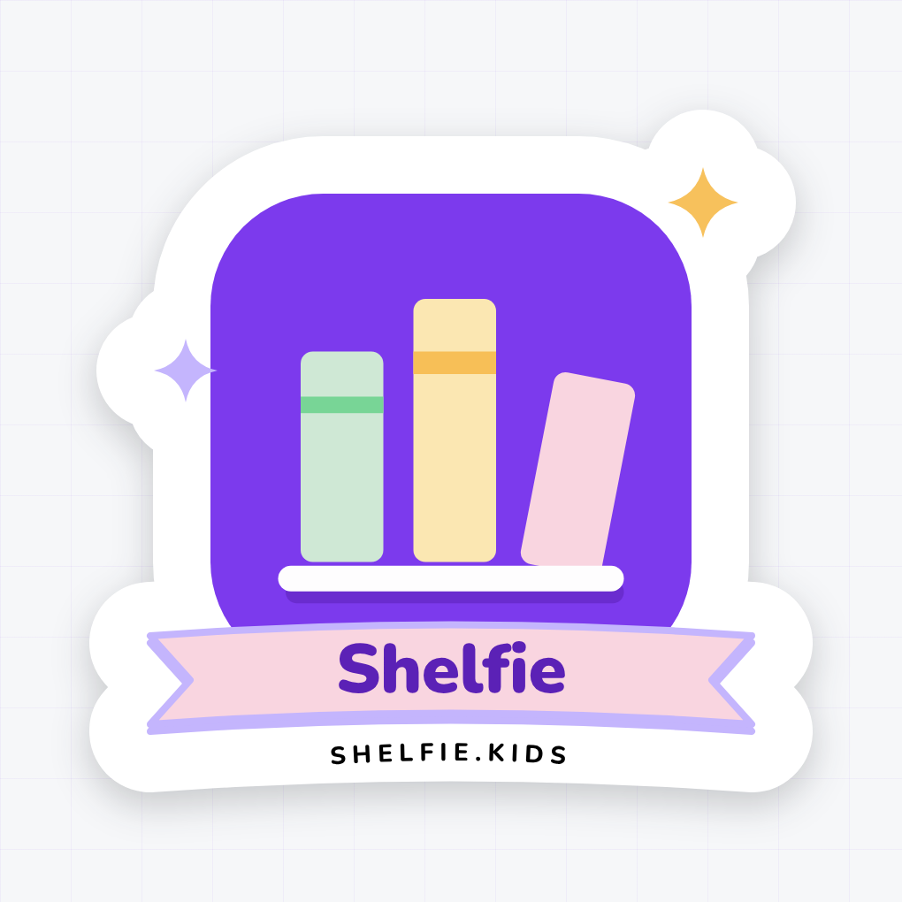
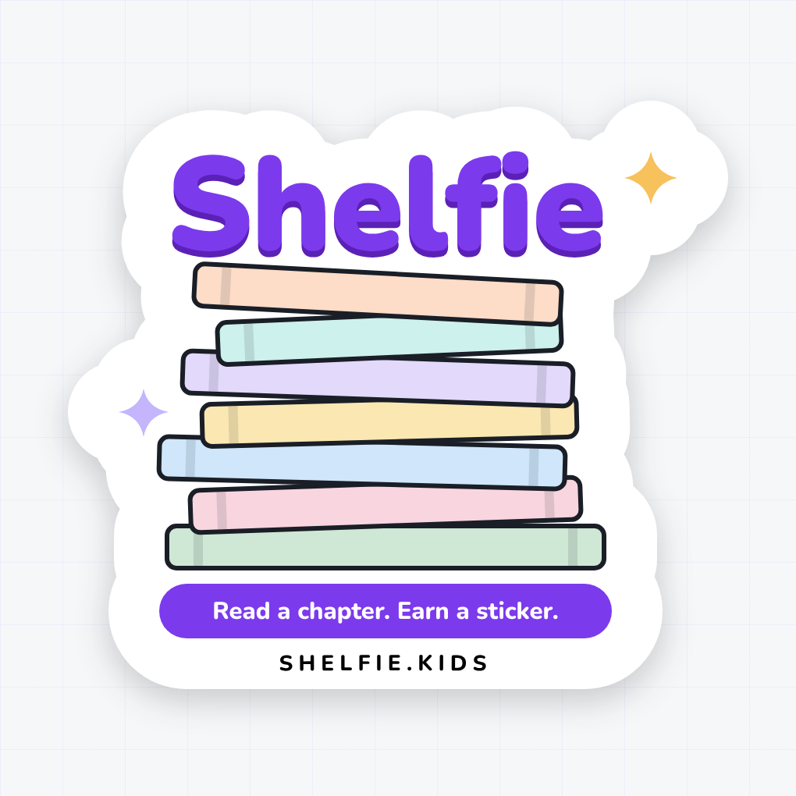
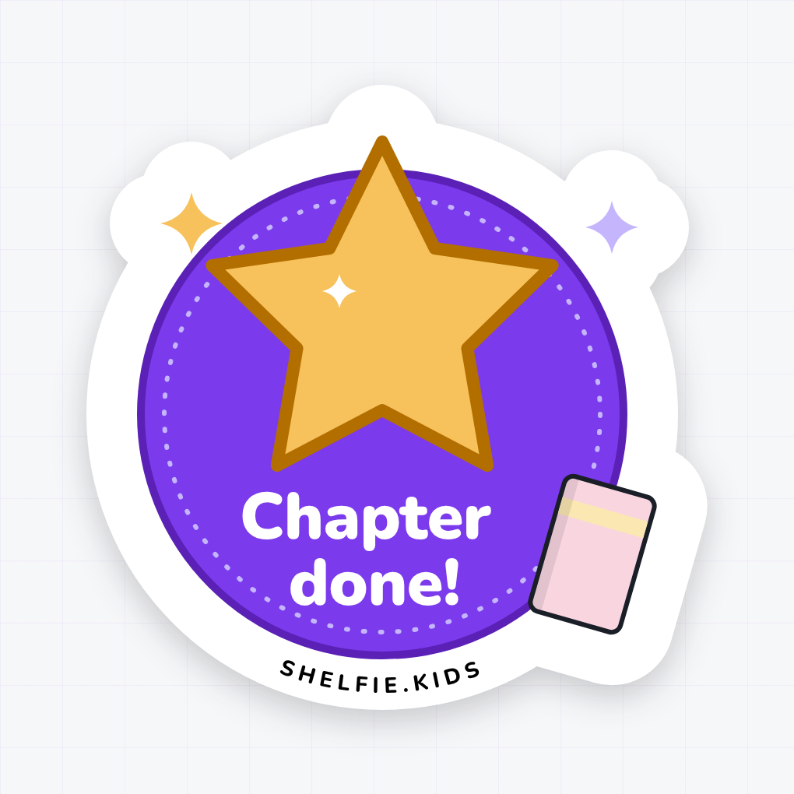
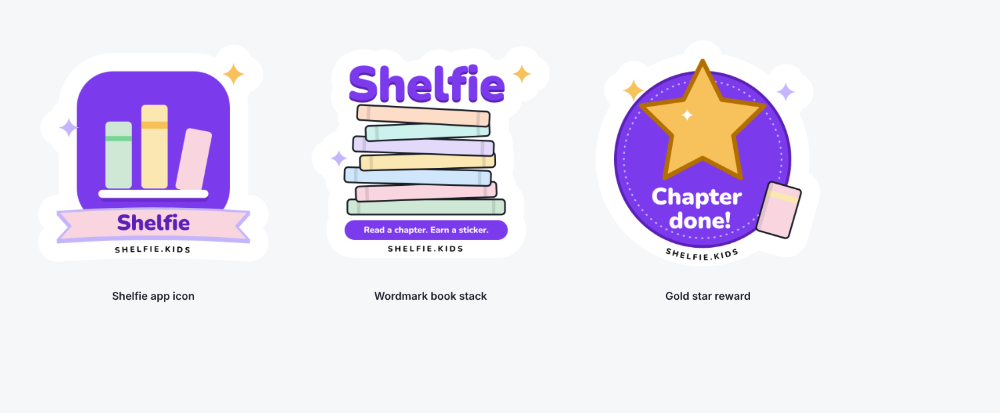

# Shelfie promotional stickers

Three die-cut vinyl stickers to give away for laptop lids, water bottles and
book bags. They are promotional artwork, not an app feature: the in-app
stickers (`sh-sticker-picker`) are separate and unchanged. Every shape, colour
and typeface comes from Shelfie's own assets rather than being redrawn by eye,
so a sticker on a laptop and the app on a phone read as the same product.

| Source of truth | Reused for |
|---|---|
| `docs/design-system/tokens/tokens.css` | the whole palette: violet-300/600/800, the seven cover pastels, amber-300/500 for the star, gray-900 (`--color-fg-on-cover`) for edges, and `--radius-md` corners on the books |
| `docs/mocks/assets/logo.svg` | the app icon on sticker 1, verbatim: violet tile, three books, white shelf |
| `.cover` in `docs/design-system/assets/components.css` | book proportions (2:3), corners and the darker spine band |
| `--font-family-display` and `docs/design-system/foundations/typography.html` | the typeface: Nunito, the first web font in the stack, at 800 and 900 |
| `FEEDBACK_STICKERS` in `sticker-picker.ts` | the "Star" feedback sticker, drawn as a path instead of the emoji |
| `docs/design-system/foundations/content.html` | the voice: "Chapter 12 done!" becomes "Chapter done!" |
| `docs/runbook.md` | the production domain on the rim, `SHELFIE.KIDS` |

## The three designs

### 1 — Shelfie app icon



The app icon at badge scale on a rose ribbon. The tile is `logo.svg` verbatim
in a nested `<svg>`, which maps its 64-unit viewBox onto the canvas with
`x' = 8.5x + 178, y' = 8.5y + 130`. The ribbon carries the chunky-button idiom:
a violet-300 underlay 8px below the `#f9d5e0` face. `Shelfie` is violet-800 on
rose, 6.7:1.

### 2 — Wordmark book stack



`Shelfie` in Nunito 900, violet-600 over a violet-800 offset, on a leaning stack
of the seven cover colours (sage, rose, sky, sun, lilac, mint, peach). The
wordmark carries its own keyline, so the die cut follows the letters.
`Read a chapter. Earn a sticker.` sits in a violet-600 chip in white, 5.7:1.

### 3 — Gold star reward



The "Star" feedback sticker as a five-point path bursting out of the top of a
round violet badge, with `Chapter done!` in white Nunito 900 (5.7:1) and a rose
book in the cover's 2:3 proportion peeking over the bottom-right edge.

All three together:



## Print spec

| | |
|---|---|
| Canvas | 900 × 900 px = 3″ × 3″ at 300 DPI |
| Actual cut size | 2.66″ to 2.82″ on the long edge (see the render output for exact px) |
| Background | fully transparent (`omitBackground`), RGBA |
| Colour | sRGB. Jukebox converts to CMYK, and their proof is the check |
| Keyline | 65px of white outside the artwork on every edge (0.217″) |
| Cut line | the alpha edge of the PNG; Jukebox traces it automatically |
| Finish | designed for Super Matte; the pastels stay truer without the gloss |

Every silhouette is one connected piece. Sparkles that appear to float always
overlap the main shape's white keyline, so nothing can be cut loose. The edge
URL is 28px caps, about 2.4mm tall at 3″ and still readable at 1.5″.

### How the keyline is built

Each sticker draws its shapes twice. The first pass paints them white with a fat
round-joined stroke and `paint-order: stroke`, which puts the stroke entirely
*outside* the path; the overlapping white pieces union into one continuous
outline. The second pass paints the artwork on top. Stroke widths are the
shape's own art stroke plus `--cut-extra`, so exactly 65px of white shows past
the edge. See the `.cut-*` classes in `src/stickers.css`.

`--cut-extra` is in art-space units. Unlike the TwinkleTune reference, all three
Shelfie stickers are drawn 1:1 on the 900px canvas (each is only translated to
centre its cut), so the shared 130px default is right for every one. A sticker
that ever scales its art must override it with 130px divided by its scale.

### The edge URL

All three carry `SHELFIE.KIDS` in black Nunito 800 tracked caps, curved along
the white rim: below the ribbon on the app icon, below the chip on the book
stack, and round the bottom of the badge on the gold star, where the star fills
the top of the rim and the book sits to the right of the clear run.

## Regenerating

```bash
node docs/stickers/render-stickers.mjs
```

Playwright is the e2e workspace's `@playwright/test`, which npm hoists to the
repo root `node_modules`, so there is nothing extra to install once `npm ci` has
been run (and `npx playwright install chromium`, as for the e2e tests). Set
`SHELFIE_MODULE_ROOT` to resolve it from elsewhere, and `SHELFIE_CHROMIUM` to a
Chromium executable if Playwright's own browser is not installed.

The script writes the print PNGs, the preview PNGs, the standalone SVGs and the
contact sheet, and fails loudly if:

- Nunito (800 or 900) silently fell back to a system font,
- a PNG is not 900 × 900 RGBA,
- any corner pixel is opaque (`omitBackground` did not take), or
- the artwork touches the canvas edge, which would clip the die cut.

It also prints each sticker's measured alpha bounding box, the die cut, in px
and inches, with its margins.

## Files

```
docs/stickers/
  sticker-N-*.png            print-ready, transparent, 900 × 900
  sticker-N-*-preview.png    on paper, with a drop shadow, for review only
  sticker-N-*.svg            standalone editable vector (generated)
  contact-sheet.png          all three at review size
  render-stickers.mjs        the renderer
  README.md
  src/
    sticker-N-*.html         the artwork, edit these
    stickers.css             palette, stage, keyline rules, @font-face
    fonts/                   Nunito variable TTF, OFL licence
```

Edit the HTML, never the SVG. The SVG is regenerated from it on every run.

## Sending these to a printer

Reference product: [Jukebox die-cut stickers](https://www.jukeboxprint.com/custom-stickers/die-cut).

1. Choose **Die Cut → Custom shape → 3″ × 3″ → Super Matte**.
2. Upload the print PNG (not the preview, not the SVG). Their sticker maker
   generates the cut line from the transparent edge, which is what the white
   keyline was sized for.
3. Check the free digital proof, specifically that the cut line follows the
   outside of the white border and does not clip the star points or sparkles.

The SVGs are there for editing and for printers who want vector. They contain a
hidden `#cutline` layer tracing the artwork outline in magenta (the cut itself
runs 65px outside it), and their text is **live**, with Nunito embedded as a
data URI so it renders the same everywhere. Outline the type before sending the
SVG to a printer that is not rasterising the PNG.

## Fonts

`src/fonts/` carries Nunito as a variable TTF with its SIL Open Font Licence
text, so rendering never touches the network and the licence travels with the
files. Shelfie has no display face of its own: `--font-family-display` asks for
`ui-rounded` and `SF Pro Rounded` first, which are system fonts that cannot be
bundled, so Nunito, the first web font in that stack, is used for everything.
